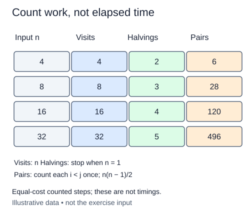

# Compare growth by running counted work

Put three work patterns beside one another for the same input size. A single pass, a distinct-pair scan, and repeated halving all accept a size n, but their counts grow differently. Build a report of observed loop work rather than guessing a complexity label.

## A fresh comparison experiment

This is a new standalone function, not a class continuation. For each nonnegative size in `sizes`, run three small experiments. Visit each position once; visit each pair of distinct positions once with the second index larger than the first; and repeatedly integer-halve a remaining size until it is at most one. Start each experiment's counter at zero for every new size.

Return one tuple `(n, visits, pairs, reductions)` per input entry. Preserve input order and repeated sizes. The loops need not build values or pair lists because this report only measures work. Use `range(n)` to produce indices without allocating a list of n values. The supplied Run probe displays the report for a few sizes; it is not the only input the function must handle.

```python
for size in [3, 6]:
    print(size, list(range(size)))
# 3 [0, 1, 2]
# 6 [0, 1, 2, 3, 4, 5]
```

The first count doubles when the size doubles. The pair count grows faster because both indices have more possibilities. Halving adds only a small number of iterations. These observations motivate O(n), O(n²), and O(log n), but Big O does not specify exact counts or measured speed.



Read these columns by their labels: the figure puts halvings before pairs, while your report tuple puts pairs before reductions.

## Account for the experiment itself

The report function performs the quadratic experiment, so its own time is O(sum of n²) over the requested sizes, plus fixed per-size overhead. Avoid huge inputs; the purpose is a small deterministic comparison. Apart from the returned report, counters and loop indices use constant auxiliary space under our bounded-integer model. Reject a negative size with `ValueError`. Empty input produces an empty report, and size zero still produces a row with three zero counts.

## Build in small steps

The report loop initializes each row and appends its tuple for you. Fill one work experiment at a time. Each column has its own check; the final check also checks the completed report and the use of loops.

## Your Tasks

1. Raise `ValueError` for a negative report size.
2. Run a single pass and increment `visits` for each position.
3. Run nested i < j loops and count the pairs.
4. Halve `remaining` repeatedly and count the reductions.

## Run and check

Edit `main.py`, then press **Run** to inspect the supplied probe. Press **Submit** to check the operation on additional inputs. You do not need to copy code from another lesson.
