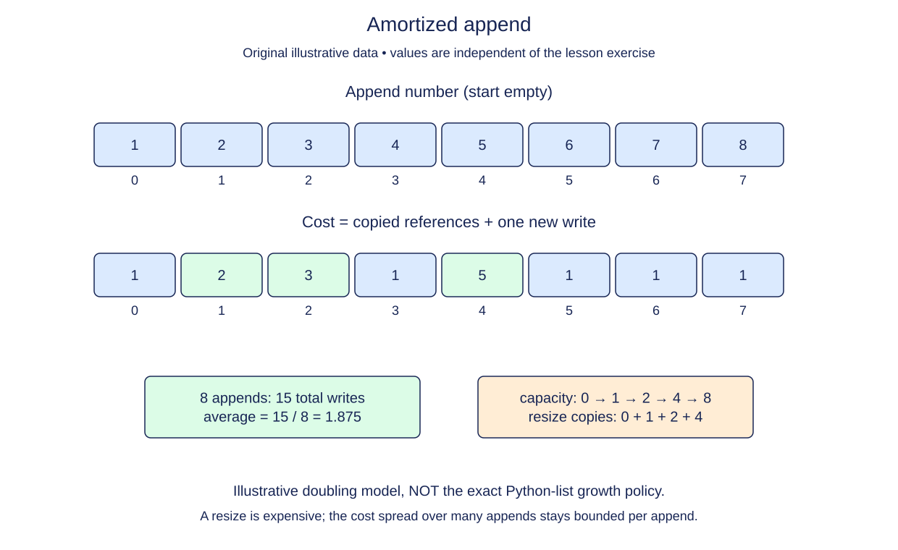

# Model amortized append cost

A growable array sometimes needs a larger storage block. One append can therefore be expensive even though a long sequence of appends is cheap on average. Build a small capacity model to see where the expensive operations occur.

## Our explicit model

Start with size zero and capacity zero. Before each append, check whether size equals capacity. If full, choose capacity one for the first allocation or double the existing capacity, and count one copy for each existing element. Then count one write for the new element and increase size. Record that append's total copy-and-write cost.

This is a teaching model, not an inspection of Python's allocator. A Python list stores references and has an implementation-dependent growth policy; our exact doubling rule does not claim to reproduce CPython's capacity choices. We count reference copies and writes, not bytes, allocation latency, or wall-clock seconds.

```python
old_size = 4
copies = old_size
new_value_writes = 1
print(copies + new_value_writes)  # 5
```

The snippet shows one possible resize cost, not a complete append algorithm. In the model, an append with spare capacity costs only one write. An append at a full capacity costs size + 1. Preserve that distinction when building the cost list.



The expensive appends occur only at full capacity; the intervening appends each need one new write.

## Average over a sequence

When capacities double, copied block sizes form a geometric sequence. Their total over n appends is O(n), so total work including the n writes is O(n). Dividing across the sequence gives amortized O(1) per append. This is not a promise that every append costs one, nor a claim about probability.

Return `(costs, capacity)` after n appends. The final capacity may exceed n because spare slots are deliberate. For n = 0, return an empty cost list and zero capacity. Reject negative n. The simulation performs n loop iterations and stores n costs, so it uses O(n) time and O(n) output space. Its size, capacity, and current cost need constant auxiliary space under the bounded-integer model.

## Build in small steps

The simulation loop already charges the new write, advances size, and records the cost. Complete input validation first. Then fill the full-capacity branch: those two updates model one resize event.

## Your Tasks

1. Raise `ValueError` when n is negative.
2. When full, charge the existing-element copies and grow capacity to one or double.

## Run and check

Edit `main.py`, then press **Run** to inspect the supplied probe. Press **Submit** to check the operation on additional inputs. You do not need to copy code from another lesson.
