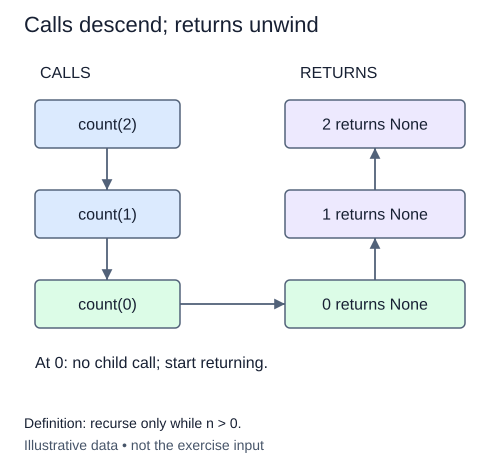

# Trace calls entering and leaving

A recursive call pauses its caller. A line before that call runs on the way down; a line after it runs only after the smaller call has returned. Record both events so the order is visible without depending on console formatting.

## One shared event list

This is a new tracing function. `countdown_trace(n)` creates a fresh list and defines a nested helper `walk(k)`. A nested function can read the enclosing function's local variables. Here every helper call appends to the same event list; it does not create a new list for each level.

On entry, record `("enter", k)`. If k is positive, visit k - 1. Finally record `("leave", k)`, including when k is zero. For n = 2, entries occur for 2, 1, and 0. Leaves then occur for 0, 1, and 2. The base call has both an entry and a leave even though it does not make another call.

```python
events: list[tuple[str, int]] = []
events.append(("opened", 4))
events.append(("closed", 4))
print(events)  # [('opened', 4), ('closed', 4)]
```

The tuple keeps a label and its integer argument together. The annotation `list[tuple[str, int]]` describes a list of those pairs. The example shows the recording format, not recursion or the requested event sequence.



The pictured calls return `None`, like your `walk` helper; the outer `countdown_trace` function returns the event list they fill.

## Preserve return order

Keep the leave event after the recursive call. Moving it above the call would make each level appear finished before its child begins. Forgetting the leave at zero would omit the deepest return. Avoid a mutable default event-list argument: separate calls to the public function must produce separate lists.

Validate n using the supplied helper, with the same integer range zero through 100. There are n + 1 calls to the recursive helper and twice as many events. Time, returned event storage, and maximum stack depth are all O(n). This trace is deliberately small enough to inspect. It will help explain why factorial can multiply after a recursive call and why the deepest call returns first.

## Build in small steps

The fresh list, helper, entry event, and outer call are supplied. You add validation, recursive descent, and the return-side event separately. The entry-only check does not need leave events yet.

## Your Tasks

1. Validate n with `_check_n(n)` before doing any work.
2. Call the helper with k - 1 when k is positive.
3. Append the leave event after the recursive call returns.

## Run and check

Edit `main.py`, then press **Run** to inspect the supplied probe. Press **Submit** to check the operation on additional inputs. You do not need to copy code from another lesson.
