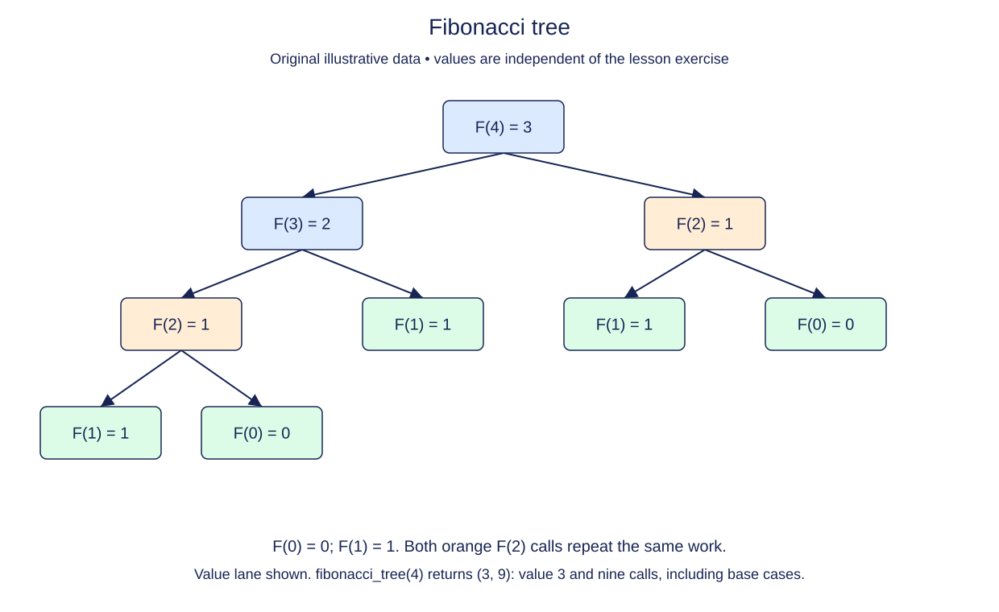

# Fibonacci as a branching call tree

Fibonacci numbers start with F(0) = 0 and F(1) = 1. Every later value is the sum of the preceding two. Unlike factorial, a direct recursive implementation makes two smaller calls, so its execution branches.

## Two base cases, two branches

For n greater than one, ask for F(n - 1) and F(n - 2), then add their values. The two base cases return directly. Both arguments are smaller, but that alone does not make the algorithm efficient. The same subproblem can appear in several branches.

For F(4), the branches request F(3) and F(2). Computing F(3) requests F(2) again. Each copy of F(2) then repeats its own work. These are separate function calls even though their arguments and results match. A call tree shows repeated work that a simple linear trace can hide.

```python
known = [0, 1, 1, 2, 3]
print(known[3] + known[4])  # 5
```

The snippet combines already known values. Your implementation must obtain both smaller values recursively rather than looking them up in this list.



Count every box, including the repeated F(2) subtrees, when finding the total calls rather than the maximum depth.

## Count the whole tree

Write a fresh function `fibonacci_tree(n)` returning `(value, calls)`. A base case has one call. A non-base call contributes one for itself plus every call in both subtrees. Count both branches even when they produce equal values. Do not confuse the number of simultaneously active frames with the total number of calls over the whole run.

Use `_check_n(n, 12)` to limit this intentionally inefficient exercise to integers from zero through 12. The direct algorithm has exponential time; O(2^n) is a convenient upper bound under a unit-addition model. Maximum stack depth is O(n), because one branch finishes before its sibling is evaluated. The function returns only a value and count, not the entire call tree, so it does not retain every completed frame.

Do not add caching yet. The following lesson will keep the recurrence while remembering completed subproblems, and the call-work contrast will be visible without timing anything.

## Build in small steps

The branch condition is supplied. Once validation and the two base answers work, the remaining change is one branching recurrence. Include one call for the current node when combining its two subtrees.

## Your Tasks

1. Validate n with `_check_n(n, 12)` before doing any work.
2. Return `(n, 1)` for either base index zero or one.
3. Combine the two smaller values and both subtree call counts.

## Run and check

Edit `main.py`, then press **Run** to inspect the supplied probe. Press **Submit** to check the operation on additional inputs. You do not need to copy code from another lesson.
