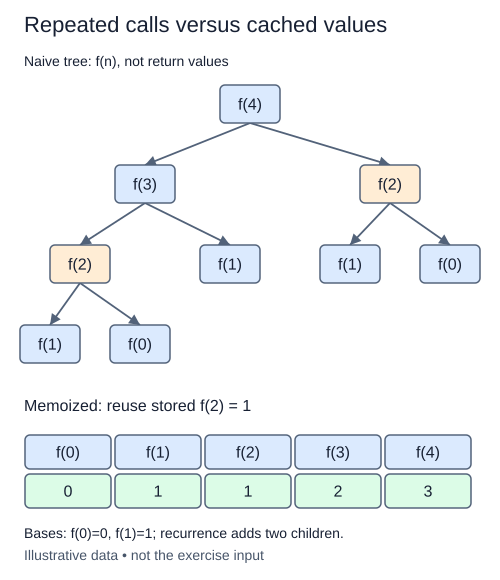

# Memoize completed Fibonacci subproblems

The previous call tree computed the same Fibonacci index many times. Keep a table of completed answers so a repeated request can return immediately. This technique is called memoization: the recurrence stays the same, but repeated subproblems reuse work.

## A cache belongs to one calculation

This is a fresh variation, `fibonacci_memo(n)`. Create an empty dictionary inside the public function, then use a nested helper `fib(k)`. A dictionary maps keys to values. Here the key is an integer index and the value is its Fibonacci number. `if k in cache` asks whether an answer has already been stored; `cache[k]` retrieves or assigns that answer.

```python
cache: dict[int, int] = {}
cache[3] = 2
print(3 in cache, cache[3])  # True 2
print(4 in cache)           # False
```

Check the cache before doing the base or recursive work. On a miss, compute the answer, store it, then return it. Store the base answers too. A cached zero is a valid answer, so do not use the answer's truthiness to decide whether an entry exists.



The table shows stored answers after computation, including the bases; your exercise starts with an empty cache and counts solving those bases as misses too.

## Count newly solved indices

Return `(value, misses)`, counting one miss each time an index is solved for the first time. A local counter in the public function can be updated inside `fib` with `nonlocal misses`; that declaration means assignment refers to the enclosing variable rather than creating a new helper-local variable. Cache hits do not increase this counter.

A request for zero or one solves only that index. For n at least two, the recursion solves every index from zero through n once, then reuses those stored answers on repeated requests. A new public call starts with an empty cache, so results and counts do not depend on earlier runs. Avoid a mutable default dictionary that would retain old entries.

Validate n with `_check_n`, accepting zero through 100. Assuming expected constant-time dictionary operations and unit-cost arithmetic, time is O(n). The cache and stack both use O(n) space. Integer values grow, so the actual byte and arithmetic costs also depend on their sizes. This lesson counts first-time subproblem evaluations rather than all helper calls, making the avoided repeated work explicit.

## Build in small steps

The starter supplies the local cache, base values, miss counter, and storage of completed answers. First validate input. Next connect the two recursive branches; the small value-only checks tolerate repeated work. Finally make the cache-hit branch return early, which removes repeated evaluations and makes the miss-count checks pass. Until that early return works, keep experiments to the small supplied probe; larger valid inputs would still repeat the exponential call tree.

## Your Tasks

1. Validate n with `_check_n(n)` before doing any work.
2. Compute a non-base value from the two recursive Fibonacci results.
3. Return the stored answer immediately on a cache hit.

## Run and check

Edit `main.py`, then press **Run** to inspect the supplied probe. Press **Submit** to check the operation on additional inputs. You do not need to copy code from another lesson.
