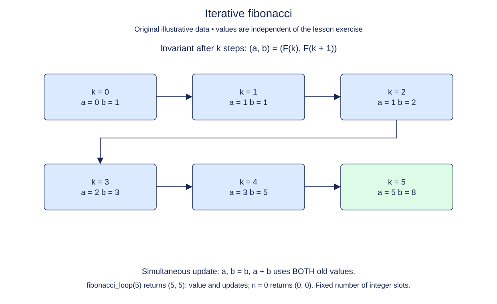

# Iterative Fibonacci with two live values

Memoization keeps answers for all earlier indices, but a forward Fibonacci calculation needs only the two most recent values. Replace the recursive call structure with a loop whose state describes adjacent positions in the sequence.

## State before an iteration

Start with a = F(0) and b = F(1). After k updates, keep the invariant a = F(k) and b = F(k + 1). One update moves the pair forward: the new first value is the old second value, and the new second value is the sum of the old pair.

Both new values depend on the old state. Python's parallel assignment evaluates the right-hand side before assigning either name. Alternatively, save the next value in a temporary variable. Updating a first and then using the changed a to calculate b would accidentally double the wrong number.

```python
left, right = 4, 7
left, right = right, left + right
print(left, right)  # 7 11
```

This small example uses different starting values to expose the simultaneous-update rule. In the exercise, begin with the Fibonacci bases and perform n updates. After those updates, a holds F(n). No special case is required to produce zero: when n is zero, the initial a is already the answer.



After each update, the left value is the answer for the completed step count and the right value is the next Fibonacci number.

## Compare storage, not just the answer

This is a new standalone variation, `fibonacci_loop(n)`, returning `(value, updates)`. Count one update per iteration. The supplied `_check_n` permits integer n from zero through 100. Use a real loop, not recursion, a precomputed table, or a floating-point closed form.

The operation count is O(n), and the algorithm keeps a constant number of integer variables rather than O(n) cached entries or stack frames. Calling that O(1) auxiliary space assumes bounded-size numeric values; the exact integers themselves need more bits as n grows. That caveat applies even though the number of variables stays constant. Returning the update count beside the value lets you compare this version with the earlier tree and memoized versions without unreliable timing measurements.

## Build in small steps

The initial pair, n-iteration loop, and result tuple are supplied. Work on the pair update independently from its counter; the value check does not require a finished update count.

## Your Tasks

1. Validate n with `_check_n(n)` before doing any work.
2. Advance `(a, b)` by one Fibonacci position using the old pair.
3. Count one update per supplied loop iteration.

## Run and check

Edit `main.py`, then press **Run** to inspect the supplied probe. Press **Submit** to check the operation on additional inputs. You do not need to copy code from another lesson.
