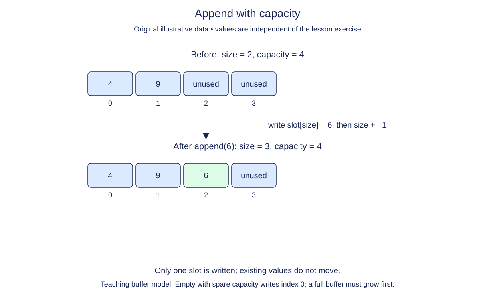

# Append with modeled capacity

Continue the same array by adding a value after its occupied prefix. Most appends fit an unused slot. When all slots are occupied, a supplied growth helper makes a larger block first. Your append method coordinates these two cases.

## Preserve the existing prefix

The previous constructor, snapshot, and get method are supplied unchanged. The new `_grow()` helper allocates twice the current capacity, copies the size existing references in order, replaces `_data`, and updates capacity. It does not change size or add the new value. Read that helper before writing `append`: it separates storage growth from the logical addition of an element.

Check fullness before the write. When size equals capacity, call `_grow()` once. The next unused slot is at index size, so place the new reference there and then increase size. Increasing size first would skip a slot. Return `None`, matching the convention for a mutating operation whose purpose is its side effect.

```python
slots = ["red", None, None]
used = 1
slots[used] = "green"
used += 1
print(slots[:used])  # ['red', 'green']
```

The snippet shows a write into already available space. Your method also handles a full array and preserves every existing element when the helper grows storage. An empty array starts with capacity one; its first append needs no growth. Appending `None` is valid because size, not slot contents, identifies occupancy.



This spare-capacity case writes one slot without moving existing values; a full buffer must grow before the same write.

## Costs across repeated appends

A spare-capacity append uses O(1) work. Growing a full array copies O(n) references and temporarily needs a second O(n) block. With the explicit doubling policy, a sequence of n appends performs O(n) total copying, making append amortized O(1). The final modeled storage is O(n).

Do not use Python list `append` or `insert` on `_data`: that would change the slot count behind the model's capacity bookkeeping. Write by index and use the supplied helper. The model's capacity is deliberately observable for learning and is not the capacity of the underlying CPython list. Independent `Array` instances must have independent slot lists even when some of their payload references are shared.

## Build in small steps

The growth helper is complete. First make room, then write the reference, then advance logical size. The unfinished write raises a caught `NotImplementedError` so Run is safe and the growth check can inspect an intermediate state. Once the write is complete, the next check can inspect the slot before size is updated.

## Your Tasks

1. Call `_grow()` if the array is full.
2. Write the new reference into the next unused slot.
3. Increase size by one after writing the value.

## Run and check

Edit `main.py`, then press **Run** to inspect the supplied probe. Press **Submit** to check the operation on additional inputs. You do not need to copy code from another lesson.
