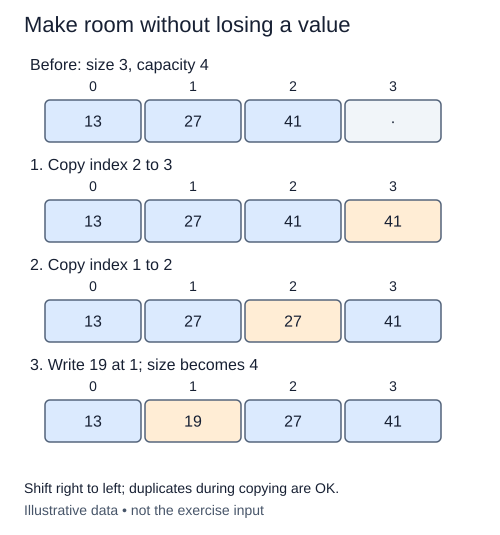

# Insert by shifting from the right

Appending writes after the occupied region. Inserting into the middle must make a gap without destroying the references already stored there. Continue the array class by shifting the suffix one slot to the right.

## Copy in the safe direction

The constructor and previous methods are complete. Validate the insertion boundary before changing storage: integer indices from zero through size are allowed. Index size means append at the end; it is a valid insertion boundary even though it is not a valid read index. Negative indices and larger boundaries raise `IndexError` without changing the array.

If full, use `_grow()` to create a spare slot. Then begin at the old size and work backward toward index + 1. Each destination receives the reference immediately to its left. Moving right to left preserves the source reference until it has been copied. A forward loop would overwrite a value before a later iteration had saved it.

```python
slots = ["A", "B", "C", None]
slots[3] = slots[2]
slots[2] = slots[1]
print(slots)  # ['A', 'B', 'B', 'C']
```

This trace opens index one while preserving B and C to its right. The insertion operation still needs to write the new value into the gap and update size. Duplicate-looking slots during the shift are temporary; the final occupied prefix must contain every original value once plus the inserted value.



Copying from the right preserves each source until it has moved, even though intermediate slots temporarily repeat references.

## Boundaries explain the work

Insertion at zero shifts every occupied reference. Insertion at the end shifts none, though a full array may still need growth. Away from resizing, inserting at index i shifts size - i references. Worst-case time is O(n), and the shift itself uses O(1) auxiliary space; growth may allocate O(n) storage.

Do not call Python's `insert`, use slicing to rebuild the list, or sort the values. Those operations skip the direction-of-copy practice. Keep `_data` the same object when no growth is necessary, leave unused slots as `None`, and return `None`. The earlier append and access contracts remain available unchanged. The next lesson moves references in the opposite direction to close a deletion gap.

## Build in small steps

The full-capacity check reuses the supplied growth helper. Validate first, open the gap next, then write its new reference and advance size in separate steps. The shift check inspects only the moved suffix; the write check inspects the new slot without needing an updated size.

## Your Tasks

1. Reject invalid indices with `IndexError` before accessing or changing storage.
2. Shift the suffix one slot right, copying from right to left.
3. Write the supplied reference into the opened gap.
4. Increase size after filling the gap.

## Run and check

Edit `main.py`, then press **Run** to inspect the supplied probe. Press **Submit** to check the operation on additional inputs. You do not need to copy code from another lesson.
