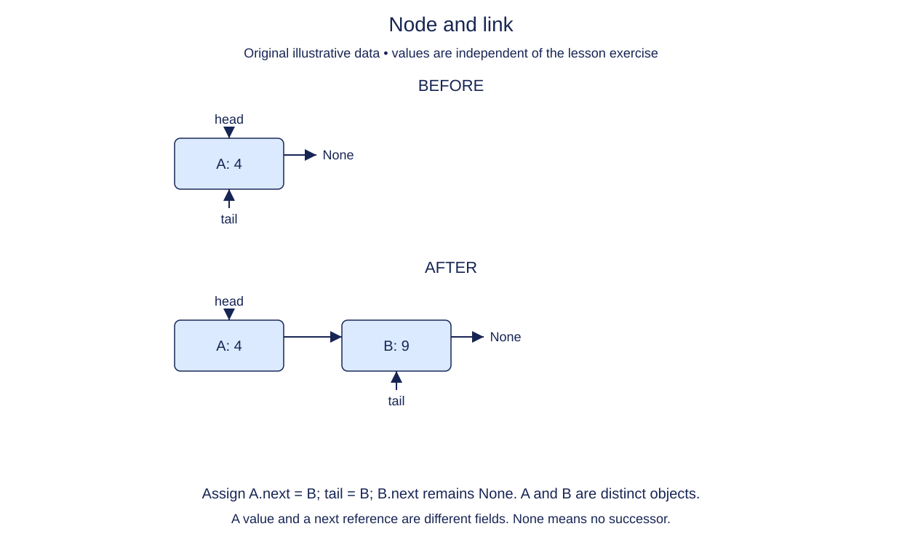

# Create a node and its link

A playlist can keep each recording in a small object and connect that object to the next recording. Start with one such object: a node. A node is not a Python list, and its link is not an index. The `next` attribute holds either another node object or `None`, which marks the end of this chain.

The supplied class header introduces `Node`. Its constructor accepts a value and an optional next node. Store the value itself rather than converting it to text or copying it. This lets a node hold a string today and a mutable record later. Two nodes can contain equal values without being the same node. Use `is` when reasoning about links and `==` when comparing stored values.

The constructor's invariant is small: every constructed node has `value` and `next`. A newly created unlinked node has `next is None`. It does not need a head, tail, or size field; those belong to the list that will own a whole chain. The caller is responsible for connecting nodes into an acyclic chain in this module.

Assigning a link does not move or duplicate an object. It creates another reference to that object. If two names refer to a node, changing that node's value is visible through both names. Changing one name to refer to a different node does not redirect all other names. This distinction will matter when we move the head of a list.

The annotations describe expected inputs and results: `object` permits any payload, `Node | None` means a node reference or no link, and `-> None` means the constructor returns no value. `from __future__ import annotations` lets the class refer to its own name before its definition has finished. Hints document the contract; they do not create links or validate values for you.

## Trace it first

For a delivery route, imagine `depot -> market -> None`. The depot node's `next` is the market node, not the word "market". Reading `depot.next.value` follows one reference and then reads one attribute. An isolated depot instead has `next is None`; do not read `.value` through that missing link.

## Cost

Construction takes O(1) time and O(1) node space because it stores two references. It does not copy the payload; payload construction is a separate cost.

## Operation contract

Implement `Node.__init__(value, next_node=None)` so each node stores the original value reference and its next-node reference; the default link is `None`.



Node and link. Before: A: 4. After: A: 4 → B: 9. Assign A.next = B; tail = B; B.next remains None. A and B are distinct objects. A value and a next reference are different fields. None means no successor.

## Your Tasks

1. Store the original payload reference in `Node.value`.
2. Store the supplied successor reference in `Node.next`.

## Run and check

Edit `Node.__init__` in `main.py`. The earlier definitions and Run probe are supplied. Run the completed operation to see:

```text
Dawn Harbor None
```

Press **Submit** to check the tasks on additional inputs and boundary cases.
