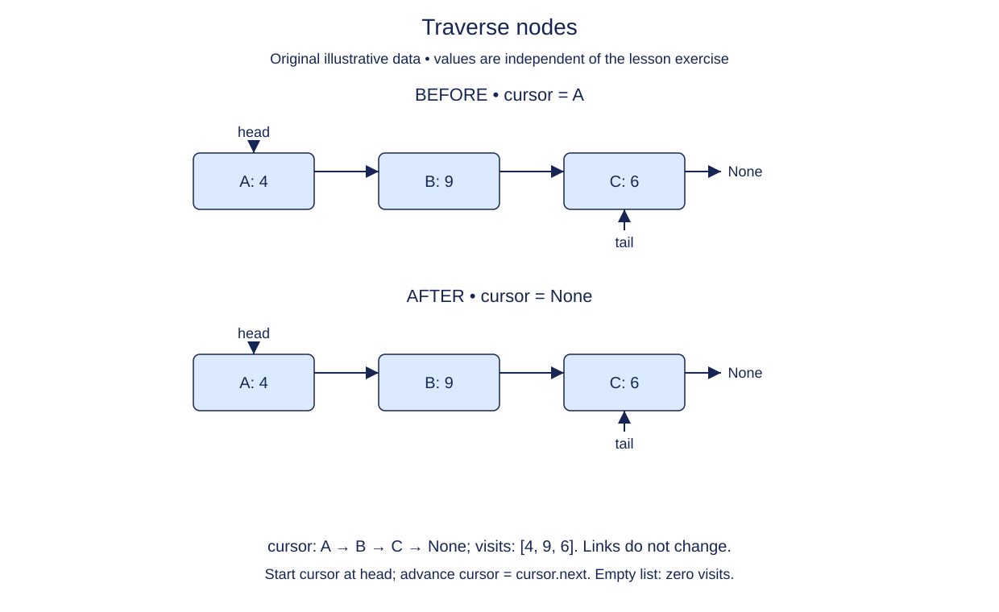

# Walk a chain without changing it

The previous node constructor is complete in this starter. Add a way to inspect a chain. You receive only its first node, so the path to the second node is the first node's `next` reference. There is no direct position lookup.

Use a local cursor to represent the next node to inspect. At the beginning of each iteration, the output contains exactly the values before that cursor. After reading the current value, advance the cursor once. When the cursor becomes `None`, every node has been visited. Test the cursor itself, not its value: `0`, `False`, an empty string, and `None` can all be legitimate payloads.

Traversal must not consume the chain. Rebinding a local variable named `current` is safe; changing `current.next` would alter the shared structure. Keep the distinction visible while tracing the code. The function returns a new output list on every call, including calls on an empty chain.

The output is a shallow collection of the payload references. The return hint `list[object]` means a Python list whose elements may be any payload objects. A mutable payload remains the same object. Editing the output list's membership must not edit the chain, but mutating a payload can still be observed through its node. We are inspecting storage, not making a deep copy.

This function assumes a finite acyclic chain. It is not a cycle detector. Circular lists later need a different stopping rule because their final link never becomes `None`.

## Trace it first

For `copper -> tin -> zinc -> None`, the cursor visits copper, tin, zinc, then None. The output grows from `[]` to `["copper"]` and eventually three values. For an empty head, the cursor starts at None and the loop executes zero times. For one node, it executes once.

## Cost

Visiting n nodes takes O(n) time. The output takes O(n) space; the cursor itself uses O(1) auxiliary space beyond the output.

## Operation contract

Implement `values(head)` to return a fresh Python list of values in link order for an acyclic chain, leaving all links unchanged.



Traverse nodes. Before: A: 4 → B: 9 → C: 6. After: A: 4 → B: 9 → C: 6. cursor: A → B → C → None; visits: [4, 9, 6]. Links do not change. Start cursor at head; advance cursor = cursor.next. Empty list: zero visits.

## Your Tasks

1. Implement `values(head)` to collect one acyclic chain in link order.

## Run and check

Edit `values` in `main.py`. The earlier definitions and Run probe are supplied. Run the completed operation to see:

```text
['Dawn', 'Harbor']
```

Press **Submit** to check the tasks on additional inputs and boundary cases.
