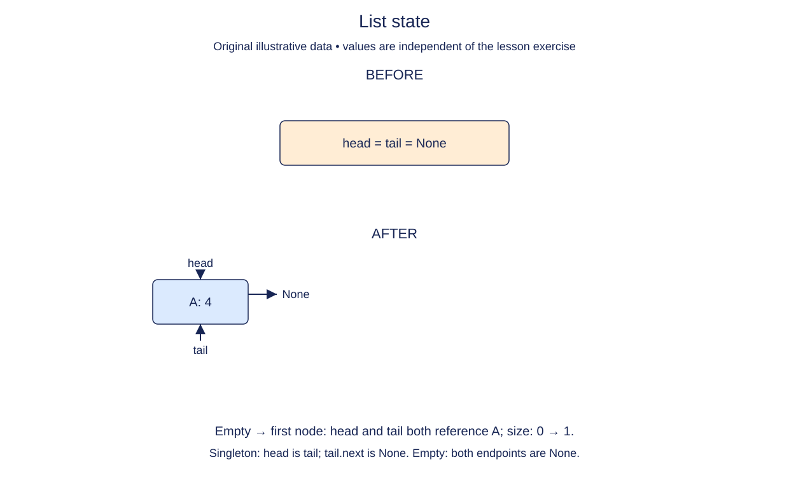

# Give the list a consistent empty state

Nodes store individual values. A list object stores the entry points and count for the whole chain. We now add `LinkedList`, while keeping the completed `Node` and `values` definitions from the previous stage.

The head points to the first node; the tail points to the last. The size counts reachable nodes, not links. Keeping a tail reference will make append possible without walking from the head each time. Keeping a size will let callers ask how many nodes exist without traversal. These conveniences also create obligations: every future mutation must update the metadata when it changes the structure.

Write down the empty-state invariant before implementing it: size is zero, head is None, and tail is None. All three describe the same fact. A list with head None but a non-None tail is inconsistent, even if traversal appears empty. For a nonempty list, following next from head must visit exactly size distinct nodes, finish at tail, and then reach None. A singleton has head and tail pointing to the same node, whose next is None.

Each list owns its own metadata. Put these attributes on `self` during initialization rather than sharing mutable state at class level. The constructor does not allocate a dummy value node: None is our empty marker. Sentinel-based structures are useful too, but this list deliberately uses real endpoints so you can practice their boundary cases.

## Trace it first

Two new lists, `morning` and `evening`, both begin with `(None, None, 0)`. This does not make them the same list. Later assigning a node to morning.head must not change evening.head. A one-node drawing has two incoming labels, head and tail, pointing to one box; it does not contain two nodes.

## Cost

Creating the empty wrapper takes O(1) time and space. Reading size will be O(1); future operations must pay the small cost of maintaining it.

## Operation contract

Implement `LinkedList.__init__()` with instance attributes `head=None`, `tail=None`, and `size=0`.



The diagram shows the empty state your constructor establishes and a later one-node state. You are not adding that node in this lesson: both endpoint fields stay `None`, and size stays zero.

## Your Tasks

1. Initialize the empty list endpoints, `head` and `tail`.
2. Initialize the list count, `size`.

## Run and check

Edit `LinkedList.__init__` in `main.py`. Annotation-only fields do not assign values yet. Complete the tasks in order. Run the completed operation to see:

```text
None None 0
```

Press **Submit** to check the tasks on additional inputs and boundary cases.
