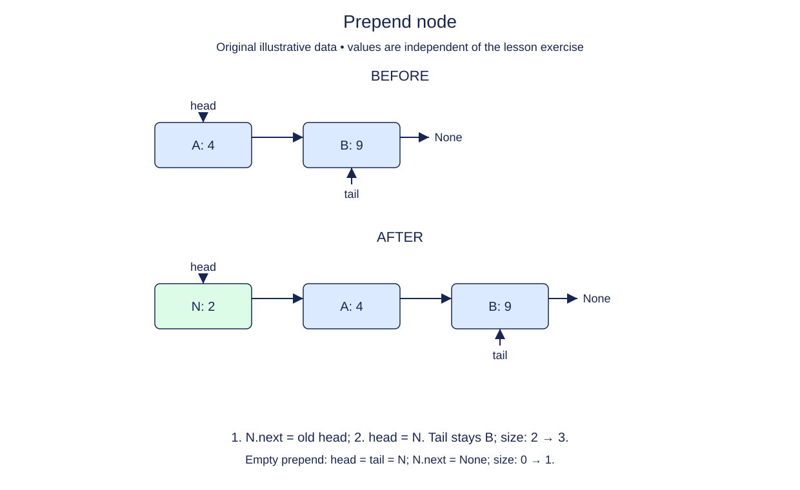

# Prepend without losing the old head

Add a recording that should play before the existing playlist. The existing head must remain reachable after the change. A common mistake is to replace head first and then try to recover its old value. Once you overwrite the only reference to a chain, you cannot reach it through the list.

Prepare the new node with a link to the old head before making it the new head. Think of this as connecting the new entry before publishing the entry point. The previous nodes keep their identities and order; none of their values need copying.

The empty case needs special attention. Its old head is None, so the new node correctly ends at None. It is also the final node, which means tail must refer to it. For a nonempty list, the old tail stays the tail. Increment size once for the one node that was added, and return the node object so callers can retain its identity for later operations.

All earlier definitions are supplied unchanged. Only prepend is unfinished. You may use the previous `values` function to inspect the result, but prepend itself must not walk the chain or convert it to a Python list. Its advantage is that it touches a fixed number of references regardless of the current length.

## Trace it first

Starting with `owl -> fox -> None`, adding hare produces `hare -> owl -> fox -> None`. Head changes from owl to hare, while tail still refers to fox. On an empty list, adding hare makes both head and tail refer to hare, and size changes from zero to one.

## Cost

Prepend takes O(1) time and allocates one O(1) node. This assumes storing a value reference is constant work; the value is not copied.

## Operation contract

Implement `prepend(value)` to attach one new node at the front, maintain head/tail/size, and return the new node.



Prepend node. Before: A: 4 → B: 9. After: N: 2 → A: 4 → B: 9. 1. N.next = old head; 2. head = N. Tail stays B; size: 2 → 3. Empty prepend: head = tail = N; N.next = None; size: 0 → 1.

## Your Tasks

1. Implement `prepend(value)` to add one new first node.

## Run and check

Edit `LinkedList.prepend` in `main.py`. The earlier definitions and Run probe are supplied. Run the completed operation to see:

```text
['Dawn', 'Harbor'] 2
```

Press **Submit** to check the tasks on additional inputs and boundary cases.
