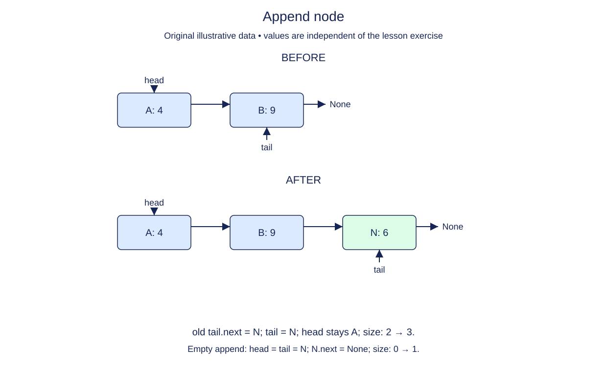

# Append through the tail reference

The playlist can now grow at either end. Append uses the tail reference that the constructor and prepend have already maintained. Without a tail, you would need to follow links from head to find the final node.

Construct the new node with no successor. On a nonempty list, the old tail is the only node whose next link changes. After connecting that link, update the wrapper's tail to the new node. Merely changing tail does not connect the node to the head's chain; traversal would miss it even though size appeared correct.

On an empty list there is no old tail whose next can be assigned. Set the head to the new node as part of this boundary case. Both cases finish with the new node as tail and one extra reachable node. Return the node rather than its payload.

The invariant provides a quick debugging checklist: the final next is None, the head still reaches all earlier nodes, and size has increased by exactly one. Repeated equal values must still create distinct nodes. Nothing about value equality changes where append operates.

Keep the previous prepend definition intact. Mixing front and back insertions is a better check than appending once to an empty list: it exposes code that resets head on every append or forgets which node is the old tail.

## Trace it first

For `map -> compass -> None`, append rope by changing compass.next, then tail. Head remains map. The finished chain is `map -> compass -> rope -> None`. A second append must connect from rope, not from compass. For the empty case, one new box receives both endpoint labels.

## Cost

Append takes O(1) time with the maintained tail and O(1) space for the new node. Finding the tail by traversal instead would take O(n).

## Operation contract

Implement `append(value)` to attach one new final node in O(1) time, maintain head/tail/size, and return that node.



Append node. Before: A: 4 → B: 9. After: A: 4 → B: 9 → N: 6. old tail.next = N; tail = N; head stays A; size: 2 → 3. Empty append: head = tail = N; N.next = None; size: 0 → 1.

## Your Tasks

1. Implement `append(value)` to add one new final node through the tail.

## Run and check

Edit `LinkedList.append` in `main.py`. The earlier definitions and Run probe are supplied. Run the completed operation to see:

```text
['Dawn', 'Harbor'] Harbor
```

Press **Submit** to check the tasks on additional inputs and boundary cases.
