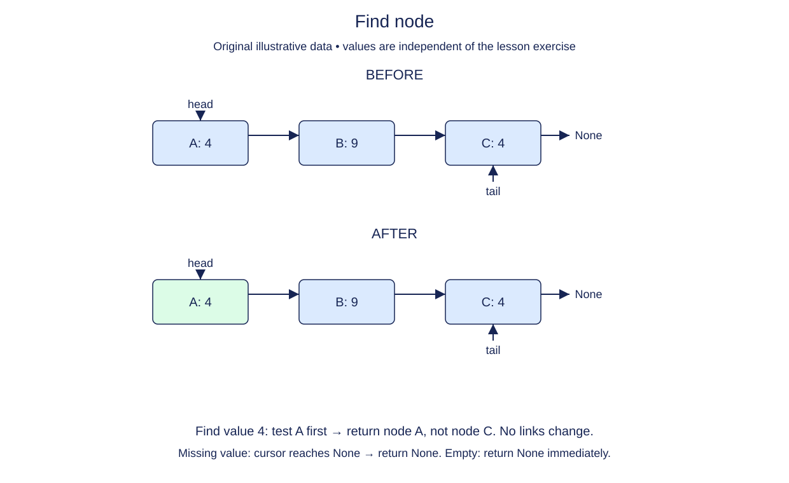

# Find the first matching node

Searching a linked list is a walk, not an index calculation. Starting from head, compare the current node's value with the requested value. Stop at the first match. Return the node itself because later operations will need a reference to a particular position.

The distinction between a value and a node matters with duplicates. If two recordings share a title, a first-match search refers to the earlier node, not a new node containing the same title and not the final equal node. Equality chooses the match; identity tells callers where it lives.

An unsuccessful search reaches None and returns None. An empty list follows that same rule without performing a comparison. A stored value of None is not the same as an absent node: searching for None can return a real Node whose value is None.

This operation must not change endpoints, links, or size. Use a local cursor rather than advancing self.head. Earlier append and prepend methods are already complete. Build different chains with them while checking your search; do not special-case the supplied titles.

The loop invariant is that all nodes before the cursor have been checked and did not match. That makes returning the first match correct and explains why no node can be skipped.

## Trace it first

In `pear -> plum -> pear -> None`, a search for pear stops at the first box. A search for plum advances once. A search for fig visits all three boxes and then reaches None. The tail stays the final pear in every case.

## Cost

Best-case search is O(1); worst-case search is O(n) equality comparisons and O(1) auxiliary space. The cost of comparing complex payloads is additional.

## Operation contract

Implement `find(value)` to return the first node with an equal value, or `None` if absent, without mutating the list.



Find node. Before: A: 4 → B: 9 → C: 4. After: A: 4 → B: 9 → C: 4. Find value 4: test A first → return node A, not node C. No links change. Missing value: cursor reaches None → return None. Empty: return None immediately.

## Your Tasks

1. Implement `find(value)` to locate the first matching node without mutation.

## Run and check

Edit `LinkedList.find` in `main.py`. The earlier definitions and Run probe are supplied. Run the completed operation to see:

```text
Harbor
```

Press **Submit** to check the tasks on additional inputs and boundary cases.
