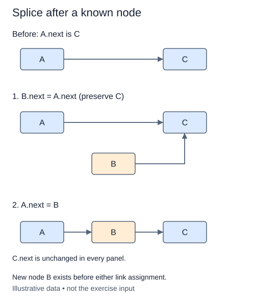

# Insert after a known predecessor

Finding a position and changing links at that position are different jobs. This lesson receives a known predecessor, so it can insert without another traversal. The caller must supply a live node in this list. Detached nodes and nodes owned by another list are outside this method's contract; validating membership would require extra state or an O(n) scan.

A predecessor may already have a successor. Save that successor in the new node before redirecting the predecessor's next. Otherwise the suffix becomes unreachable. Only one old node link needs changing; the remaining nodes keep their identities and order.

If the predecessor is the tail, the saved successor is None and the new node becomes the tail. If it is in the middle, tail does not change. Head never changes because this operation inserts after an existing node. Size increases once. There is no valid predecessor in an empty list, so passing None raises ValueError before any mutation.

The completed find method can obtain a predecessor by value, but that search has its own cost. Do not hide it inside insert_after. Returning the new node lets a caller insert again immediately after it without repeating a search.

## Trace it first

Consider `red -> blue -> green -> None`, with a reference to blue. Save green, attach a new amber node to green, then connect blue to amber. The result is `red -> blue -> amber -> green -> None`. Reversing the last two assignments can accidentally make amber point to itself.

## Cost

Insertion after a supplied live predecessor is O(1) time and one node of space. Finding that predecessor first is O(n) in the worst case.

## Operation contract

Implement `insert_after(previous, value)` for a live node belonging to this list; preserve its successor, update metadata, and return the new node. Reject `previous=None` with `ValueError` without mutation.



New node B exists before either link assignment.

## Your Tasks

1. Implement `insert_after(previous, value)` to splice a node after a known predecessor.

## Run and check

Edit `LinkedList.insert_after` in `main.py`. The earlier definitions and Run probe are supplied. Run the completed operation to see:

```text
['Dawn', 'Rain', 'Harbor']
```

Press **Submit** to check the tasks on additional inputs and boundary cases.
