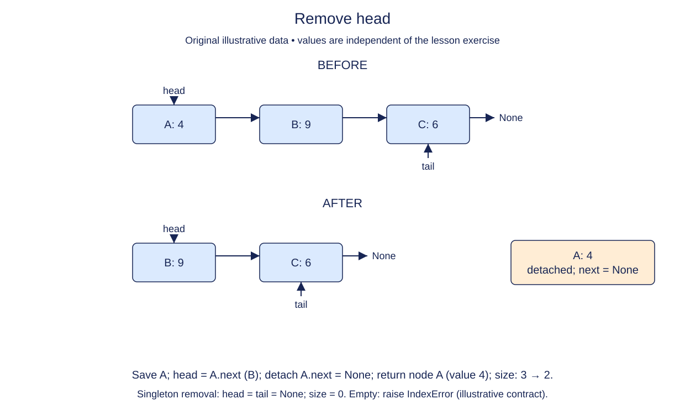

# Remove and detach the head

The next recording has finished playing. Remove its node from the front and return it so the caller can inspect what was played. Returning a node is different from returning a value: the caller can check that it received the same object originally appended.

Keep a local reference to the old head. Move the list's head to that node's successor, then detach the removed node by clearing its next link. The order matters. If you clear the link before saving or following the successor, you lose access to the remaining chain.

For a multi-node list, the tail remains unchanged. For a singleton, the new head becomes None and tail must also become None. Size decreases exactly once on a successful removal. An empty call has no node to return, so raise IndexError and leave all state unchanged.

Detaching the returned node prevents an outside reference from carrying an accidental path into the live playlist. It does not delete the Python object immediately; the caller still owns a reference to it. Nor does removal copy or destroy its payload.

This is the first deletion stage. Earlier insertion methods remain supplied and complete. After draining a list, try appending again: stale tail references often become visible only when a supposedly empty structure is reused.

## Trace it first

From `north -> south -> None`, save north, advance head to south, then set north.next to None. South is now both head and tail. Removing south next produces `(head=None, tail=None, size=0)`, while the returned south node is still readable.

## Cost

Removing the head takes O(1) time and O(1) auxiliary space. No traversal or value comparison is necessary.

## Operation contract

Implement `remove_head()` to return the detached first node, repair head/tail/size, and raise `IndexError` on an empty list without mutation.



Remove head. Before: A: 4 → B: 9 → C: 6. After: B: 9 → C: 6. Save A; head = A.next (B); detach A.next = None; return node A (value 4); size: 3 → 2. Singleton removal: head = tail = None; size = 0. Empty: raise IndexError (illustrative contract).

## Your Tasks

1. Implement `remove_head()` to detach and return the first node.

## Run and check

Edit `LinkedList.remove_head` in `main.py`. The earlier definitions and Run probe are supplied. Run the completed operation to see:

```text
Dawn ['Harbor'] None
```

Press **Submit** to check the tasks on additional inputs and boundary cases.
