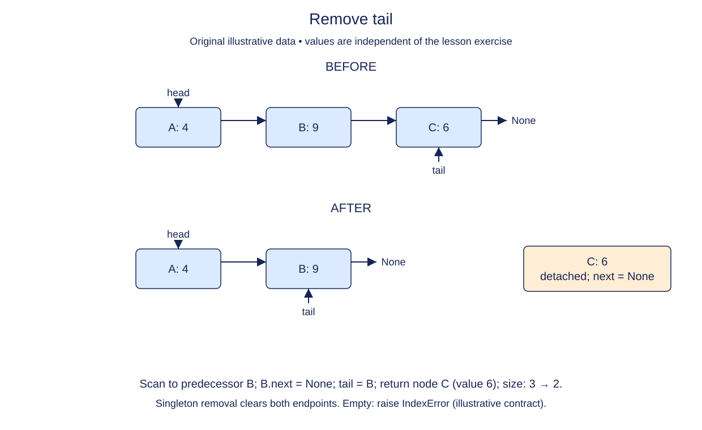

# Find the predecessor before removing the tail

A tail reference makes the final node easy to read. It does not tell a singly linked list which node comes before it. To remove the tail, you must find that predecessor so you can make it the new endpoint.

Handle the empty and singleton cases before walking. An empty list raises IndexError without change. A singleton can reuse the completed remove_head method because its first and last node are the same object. Compare their identities, not their values: a longer list can contain equal values at both ends.

For a longer chain, move a cursor until its next is the current tail. The cursor then identifies the new tail. Clear its next link, update the wrapper, and decrease size. The removed tail already has next None, so it is detached once the predecessor stops pointing to it.

Do not replace the whole chain with newly allocated nodes. External references returned by append must continue to identify the surviving nodes. The structure's value sequence alone is not enough to prove that links were updated correctly.

This operation is deliberately less efficient than remove_head. That difference will guide the choice of endpoint when we build a stack. It also motivates the extra backward links in the next module.

## Trace it first

For `birch -> ash -> elm -> None`, the cursor starts at birch. Since birch.next is ash rather than tail, advance once. Ash.next is elm, the tail, so stop. Clearing ash.next produces `birch -> ash -> None`; tail now points to ash.

## Cost

Worst-case tail removal is O(n) time because the predecessor must be found. Empty and singleton cases are O(1). Auxiliary space is O(1).

## Operation contract

Implement `remove_tail()` to return the detached last node and repair metadata; raise `IndexError` on an empty list.



Remove tail. Before: A: 4 → B: 9 → C: 6. After: A: 4 → B: 9. Scan to predecessor B; B.next = None; tail = B; return node C (value 6); size: 3 → 2. Singleton removal clears both endpoints. Empty: raise IndexError (illustrative contract).

## Your Tasks

1. Implement `remove_tail()` to detach and return the last node.

## Run and check

Edit `LinkedList.remove_tail` in `main.py`. The earlier definitions and Run probe are supplied. Run the completed operation to see:

```text
Harbor ['Dawn']
```

Press **Submit** to check the tasks on additional inputs and boundary cases.
