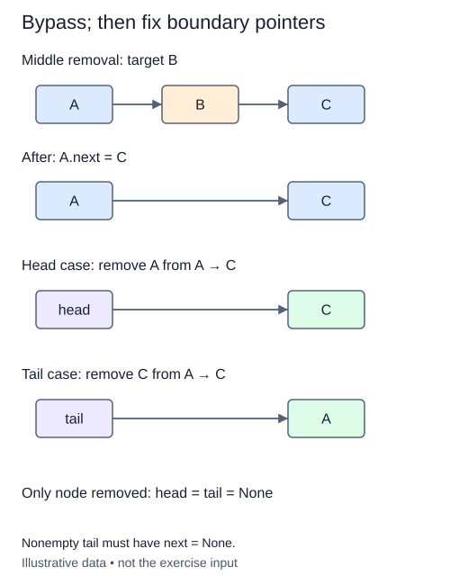

# Remove only the first matching value

Removing a named recording combines a search with a splice. Unlike find, this walk must remember the node immediately before the cursor. That predecessor is what lets you bypass a matching middle node.

Maintain two local references. Current is the candidate; previous is the node before it, or None when current is head. When no match occurs, advance both together. At a match, connect previous to current's successor. Save that successor before detaching current.

A head match has no predecessor and can reuse remove_head. A tail match requires updating tail to previous. A middle match leaves both endpoints unchanged. Return as soon as one node is removed. This method removes the first match, not every duplicate; its name is part of its contract.

If the cursor reaches None, return None and leave size unchanged. This includes an empty list. A node containing None is still a valid match and must be returned as an object, so callers can distinguish it from the no-match result.

All earlier methods remain available. Use them to build test chains containing duplicates at the head, middle, and tail. Pay attention to identities after removal: a surviving equal-valued node must not disappear just because its payload matches the removed one.

## Trace it first

In `mint -> sage -> sage -> thyme`, removing sage bypasses only the first sage box. Mint.next now reaches the second sage. The removed box's next becomes None, size decreases from four to three, and tail remains thyme. Searching for basil changes nothing.

## Cost

The search is O(n) in the worst case; the splice after finding the predecessor is O(1). The whole method uses O(1) auxiliary space.

## Operation contract

Implement `remove_first(value)` to return the detached first matching node or `None` if absent, preserving other nodes and all list invariants.



Nonempty tail must have next = None.

## Your Tasks

1. Implement `remove_first(value)` to detach the first matching node.

## Run and check

Edit `LinkedList.remove_first` in `main.py`. The earlier definitions and Run probe are supplied. Run the completed operation to see:

```text
Rain ['Dawn', 'Rain']
```

Press **Submit** to check the tasks on additional inputs and boundary cases.
