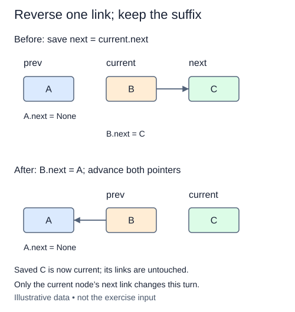

# Reverse the links in place

Reverse the playback order without replacing the recordings' nodes. Reversing values inside unchanged nodes would make external node references refer to different recordings. This exercise instead reverses the links, preserving each node and its payload.

During the walk, divide the chain into two regions: an already reversed prefix and an untouched suffix. Previous points to the front of the reversed prefix; current points to the next node to move. Before redirecting current.next toward previous, save its old successor in a third local reference. That saved successor is your only route into the untouched suffix.

After changing one link, advance previous to current and current to the saved successor. When current becomes None, previous is the new head. The original head becomes the new tail and must end at None. No nodes were added or removed, so size stays fixed.

An empty list finishes with both endpoints None. A singleton still has the same head and tail with a None link. These are ordinary outcomes of the same loop rather than reasons to allocate special nodes.

Use constant auxiliary storage for the reversal. A Python list of all nodes followed by rebuilding would produce the right values, but it would miss the pointer operation this lesson teaches. Reversing twice should restore the exact original node order.

## Trace it first

For `sun -> moon -> star -> None`, after the first step the reversed prefix is `sun -> None` and current is moon. After the second, it is `moon -> sun -> None`, while current is star. The final head is star; the final tail is sun. Losing moon before saving it would strand the remaining two nodes.

## Cost

Reversal takes O(n) time, O(1) auxiliary space, and allocates no replacement nodes. Payload size does not affect reference rewiring.

## Operation contract

Implement `reverse()` by redirecting existing next links in place, swapping endpoint roles, keeping size unchanged, and returning `None`; do not rebuild nodes or reverse payloads.



Only the current node’s next link changes this turn.

## Your Tasks

1. Implement `reverse()` to reverse existing links in place.

## Run and check

Edit `LinkedList.reverse` in `main.py`. The earlier definitions and Run probe are supplied. Run the completed operation to see:

```text
['Harbor', 'Rain', 'Dawn']
```

Press **Submit** to check the tasks on additional inputs and boundary cases.
