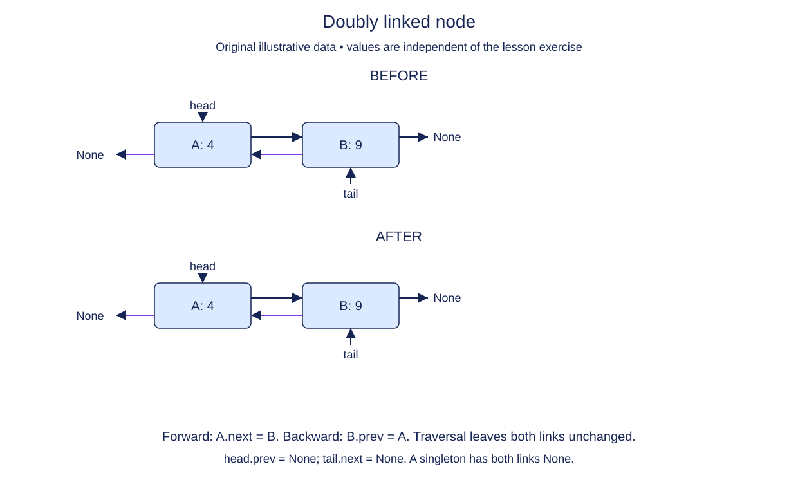

# Store a backward link as well as a forward link

Backward navigation needs information that a singly linked node does not store. A doubly linked node adds prev, a reference to the previous node. This module begins a fresh representation named DoubleNode and DoublyList; the singly linked implementation from the previous module is not being modified.

The node constructor starts detached, with both links None. A supplied DoublyList constructor initializes head and tail to None and size to zero. You will implement its operations one at a time in the next lessons. Keep values as references, just as before.

The important new invariant concerns pairs of neighbors. If A.next is B, then B.prev must be A. Reading the same chain backward from tail should visit exactly the forward nodes in reverse order. At the boundaries, head.prev is None and tail.next is None. A singleton is both endpoints and has neither neighbor. An empty wrapper has no endpoints and size zero.

Two references per node cost more storage than one, but they avoid rediscovering a predecessor when a live node is already known. They do not make arbitrary indexed access constant time. You still have to follow links to reach an unknown position.

When tracing later mutations, draw both directions separately. A forward traversal can look correct while the backward links are stale. Tests therefore need to inspect both views, not just a printed list of values.

## Trace it first

For two stop nodes, station and pier, a valid connection has station.next pointing to pier and pier.prev pointing to station. Station.prev and pier.next remain None. Equal stop labels do not imply that two node objects are interchangeable.

## Cost

Constructing a detached node takes O(1) time and space. A chain of n doubly linked nodes uses O(n) space, with one extra link per node compared with a singly linked chain.

## Operation contract

Implement `DoubleNode.__init__(value)` with the original value reference and independent `prev=None` and `next=None` attributes.



Doubly linked node. Before: A: 4 → B: 9. After: A: 4 → B: 9. Forward: A.next = B. Backward: B.prev = A. Traversal leaves both links unchanged. head.prev = None; tail.next = None. A singleton has both links None.

## Your Tasks

1. Store the original payload reference in `DoubleNode.value`.
2. Initialize both links of a detached DoubleNode.

## Run and check

Edit `DoubleNode.__init__` in `main.py`. Annotation-only fields do not assign values yet. Complete the tasks in order. Run the completed operation to see:

```text
Archive None None
```

Press **Submit** to check the tasks on additional inputs and boundary cases.
