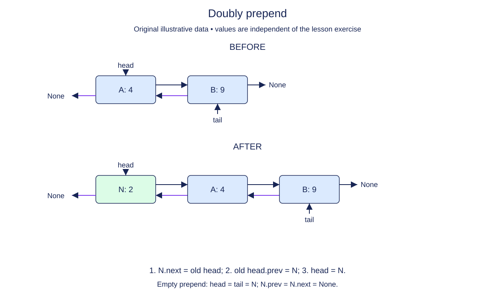

# Prepend and repair the reverse link

Prepending to a doubly linked list resembles the singly linked operation, but one additional neighbor must be repaired. The old head will no longer be first. Its prev reference must point to the new node.

Construct a detached DoubleNode, then give it the old head as its successor. If an old head exists, connect that old node backward to the newcomer. Finally publish the new head. Its prev stays None because no node precedes it.

If the list was empty, there is no old head to update. The new node becomes both head and tail, with both links None. If the list was nonempty, tail stays unchanged. Size increases once, and the method returns the newly allocated node.

A useful loop-free correctness argument examines each boundary. The new left boundary has prev None. The new adjacent pair points in both directions. Every later pair was valid before the call and remains untouched. The right boundary is unchanged unless this was the first insertion.

The starter preserves the completed node constructor and wrapper state. Do not rebuild the old chain or create a second copy for backward traversal. Both traversals must use the same node objects. Test two or more prepends; one insertion into an empty list cannot reveal a missing backward repair.

## Trace it first

With `lake <-> hill`, prepending beach adds beach.next=lake and lake.prev=beach. Head becomes beach; tail stays hill. Walking backward must now yield hill, lake, beach. If lake.prev remains None, the reverse walk stops early even though the forward walk looks correct.

## Cost

Prepend performs a fixed number of link assignments, so it takes O(1) time and one O(1) new node.

## Operation contract

Implement `DoublyList.prepend(value)` to return a new first node and preserve forward/backward links, endpoints, and size.



Doubly prepend. Before: A: 4 → B: 9. After: N: 2 → A: 4 → B: 9. 1. N.next = old head; 2. old head.prev = N; 3. head = N. Empty prepend: head = tail = N; N.prev = N.next = None.

## Your Tasks

1. Implement `DoublyList.prepend(value)` to add a new first node.

## Run and check

Edit `DoublyList.prepend` in `main.py`. The earlier definitions and Run probe are supplied. Run the completed operation to see:

```text
Home Home 2
```

Press **Submit** to check the tasks on additional inputs and boundary cases.
