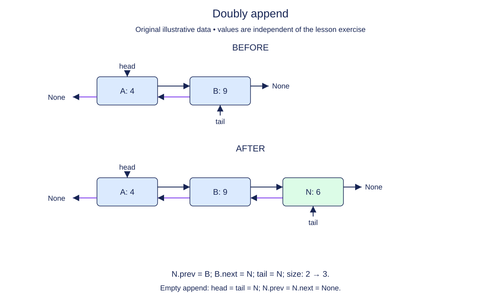

# Append with a link back to the old tail

Appending extends the right boundary of the doubly linked chain. The new node has no successor, but it does have a predecessor whenever the list is nonempty. Its prev must point to the old tail, and the old tail's next must point forward to it.

Treat those two assignments as a matched pair. Updating only the forward link leaves the new tail unable to reach the earlier nodes during a backward walk. Updating only the backward link leaves it outside the head's forward chain. After connecting the pair, move the wrapper's tail to the new node.

The empty case has no old tail, so make the new node the head as well. Its prev remains None. In all successful cases, size increases once and the returned node is exactly the new tail.

Prepend remains supplied from the preceding lesson. Mix the two insertion methods when checking your work: prepend a node, append two nodes, then prepend again. Both endpoint labels should still identify the correct objects. Values may repeat; adjacency is represented by object references, not by value lookup.

This representation now supports reaching either end in constant time. It still does not supply random access to a middle position. The next lesson will exploit a known node's prev and next references to remove it without a search.

## Trace it first

For `draft <-> review`, appending publish creates publish.prev=review and review.next=publish. Tail becomes publish, while publish.next stays None. Following prev twice from tail reaches draft, whose prev is None.

## Cost

Append takes O(1) time and O(1) additional node space because the old tail is already known.

## Operation contract

Implement `DoublyList.append(value)` to return a new final node with correct bidirectional links, endpoints, and size.



Doubly append. Before: A: 4 → B: 9. After: A: 4 → B: 9 → N: 6. N.prev = B; B.next = N; tail = N; size: 2 → 3. Empty append: head = tail = N; N.prev = N.next = None.

## Your Tasks

1. Implement `DoublyList.append(value)` to add a new final node.

## Run and check

Edit `DoublyList.append` in `main.py`. The earlier definitions and Run probe are supplied. Run the completed operation to see:

```text
Archive Home
```

Press **Submit** to check the tasks on additional inputs and boundary cases.
