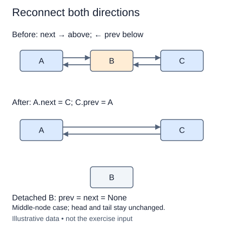

# Remove a known node in both directions

A doubly linked node knows both neighbors, so a caller that already holds the node can remove it without searching from head. The contract requires a live node belonging to this list. Foreign or previously removed nodes are outside the contract. Passing None is explicitly rejected before mutation.

Imagine closing the gap around a middle node. Its left neighbor must point forward to its right neighbor, and its right neighbor must point backward to its left neighbor. Keep the node's original links available until both repairs have used them. Then clear prev and next on the removed node.

At the left boundary there is no predecessor, so moving head replaces the forward repair. At the right boundary there is no successor, so moving tail replaces the backward repair. A singleton triggers both boundary cases and leaves both endpoints None. Decrease size once, not once per repaired direction.

The returned object is the original node. Surviving neighbors retain their identities, and removing one of several equal-valued nodes removes that exact position. Value-based deletion would first need a search, which is not the operation being implemented here.

A detached node remains readable through the caller's reference, but it no longer provides a route into the live chain. This is useful in the history application that follows, where a discarded forward branch should not remain connected to the current history.

## Trace it first

In `alpha <-> beta <-> gamma`, removing beta reconnects alpha.next to gamma and gamma.prev to alpha. Beta's links both become None. Removing alpha afterward makes gamma both head and tail, with both links None.

## Cost

Removing a supplied live node takes O(1) time and O(1) auxiliary space. Locating an unknown node by value would add O(n) worst-case search time.

## Operation contract

Implement `remove(node)` for a live node in this DoublyList, returning that same detached node and repairing both neighbors and metadata; reject `None` with `ValueError`.



Middle-node case; head and tail stay unchanged.

## Your Tasks

1. Implement `DoublyList.remove(node)` to detach a known live node.

## Run and check

Edit `DoublyList.remove` in `main.py`. The earlier definitions and Run probe are supplied. Run the completed operation to see:

```text
Home Home None None
```

Press **Submit** to check the tasks on additional inputs and boundary cases.
