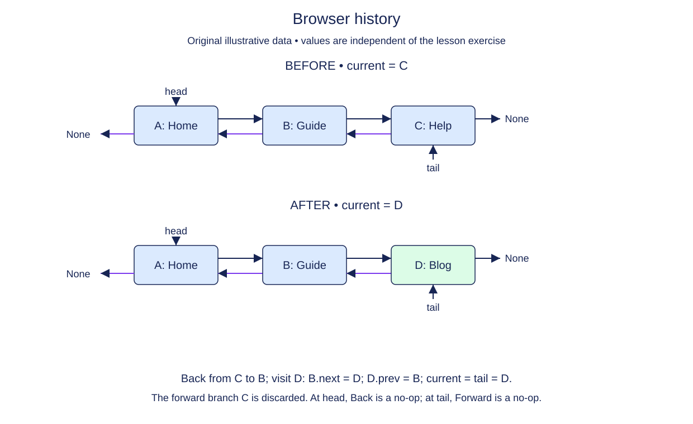

# Start a new history branch after going back

A linear browser history has a current page as well as endpoints. Going back changes the cursor; it does not delete a page. Visiting a new page after going back does delete the old forward branch. Implement that branch replacement as one operation.

The starter keeps the completed DoublyList and adds a supplied BrowserHistory wrapper. Its constructor creates one initial page, so current always refers to a live node. The supplied back and forward methods move current by one link when possible and otherwise stay at the boundary. They return the page value and never change size.

For visit, remove nodes from the tail until tail is current. These nodes are precisely the discarded forward branch. The existing remove method detaches each one and maintains size. Then append the new page and make the returned node current. Reusing those methods avoids duplicating their endpoint cases.

Page strings need not be unique. Visiting the same address twice creates two history entries because navigation records events, not a set of unique addresses. Two BrowserHistory objects must remain independent.

Our model has no network or actual browser integration. It is an in-memory application of bidirectional links. The history is never empty after construction: the current page survives branch removal and the new page is appended after it. This invariant is why the tail-removal loop has a definite stopping point.

## Trace it first

Suppose the pages are `start <-> gallery <-> map`, with current at gallery after one Back. Visiting tickets discards map and produces `start <-> gallery <-> tickets`. Forward from tickets stays at tickets. The detached map node has neither link.

## Cost

Back and forward are O(1). Visiting after discarding k forward entries takes O(k+1) time and one new node; explicitly detaching each discarded node accounts for the k term.

## Operation contract

Implement `BrowserHistory.visit(page)` to discard and detach every node after current using the supplied list operations, append the new page, make it current, and return its value.



Browser history. Before: A: Home → B: Guide → C: Help. After: A: Home → B: Guide → D: Blog. Back from C to B; visit D: B.next = D; D.prev = B; current = tail = D. The forward branch C is discarded. At head, Back is a no-op; at tail, Forward is a no-op.

## Your Tasks

1. Implement `BrowserHistory.visit(page)` to replace the forward branch with a new visit.

## Run and check

Edit `BrowserHistory.visit` in `main.py`. The earlier definitions and Run probe are supplied. Run the completed operation to see:

```text
Contact 2 Home
```

Press **Submit** to check the tasks on additional inputs and boundary cases.
