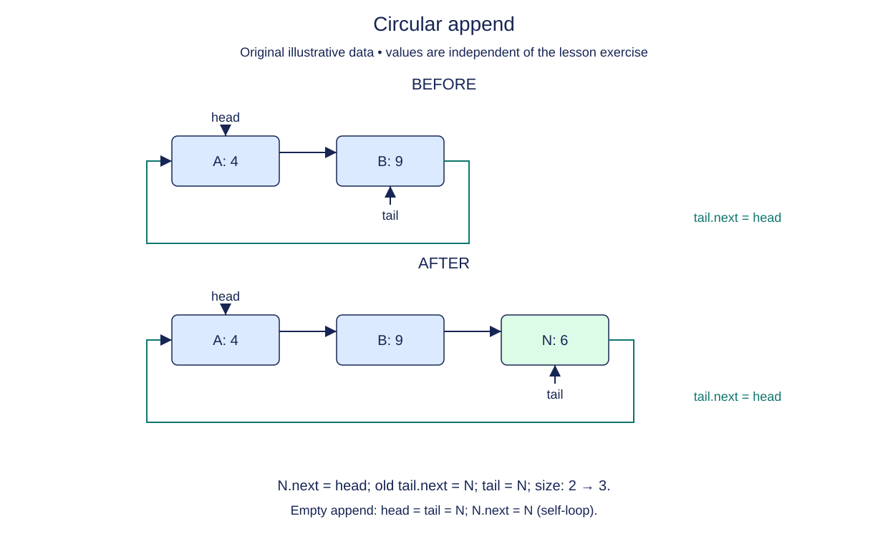

# Close a circular list after append

A repeating turn order should lead from its last participant back to its first. That is a circular list: its final next reference points to head instead of None. This lesson starts a new CircularList representation with a supplied RingNode and empty constructor. The earlier doubly linked classes remain available but are not used by this structure.

An empty ring still has head=None, tail=None, and size=0. A nonempty ring has exactly size distinct nodes before traversal returns to head. Tail is the final node in that first lap, and tail.next is head. A singleton therefore points to itself. That self-link is intentional, unlike an accidental cycle in an ordinary singly linked list.

To append to a nonempty ring, connect the new node to head and connect the old tail to the new node. Move tail and increase size. Head does not change. For the first insertion, the new node becomes both endpoints and its next points to itself.

Do not reuse a traversal that waits for None. A valid nonempty ring never reaches None, so that loop would run forever. This stage's supplied probe reads only the known endpoints. The following stage adds a bounded traversal.

The circular representation is useful for repeated scheduling, but its stopping rule must always be explicit. Size is now both useful metadata and a way to know when one lap is complete.

## Trace it first

With `tea -> coffee -> tea`, tea is head and coffee is tail. Appending water changes coffee.next to water and water.next to tea; tail becomes water. On the first insertion alone, tea.next would point to tea itself.

## Cost

Append takes O(1) time with a maintained tail and allocates one O(1) node. The ring uses O(n) total node storage.

## Operation contract

Implement `CircularList.append(value)` to return a new final node while preserving `tail.next is head` and head/tail/size, including the empty-to-singleton transition.



Circular append. Before: A: 4 → B: 9. After: A: 4 → B: 9 → N: 6. N.next = head; old tail.next = N; tail = N; size: 2 → 3. Empty append: head = tail = N; N.next = N (self-loop).

## Your Tasks

1. Implement `CircularList.append(value)` to add a node while keeping the ring closed.

## Run and check

Edit `CircularList.append` in `main.py`. The earlier definitions and Run probe are supplied. Run the completed operation to see:

```text
Ari Bo True
```

Press **Submit** to check the tasks on additional inputs and boundary cases.
