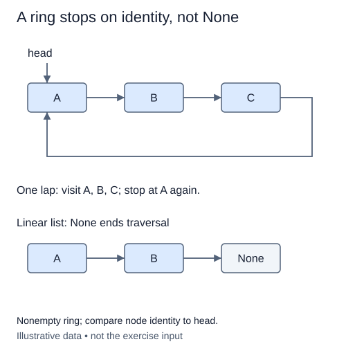

# Traverse exactly one lap

The ring now needs an inspection operation that stops. In an ordinary linked chain, None marked the end. Here tail.next returns to head, so waiting for None would never finish. Use the size invariant to visit exactly the number of nodes in the ring.

A local cursor starts at head. Read one payload, advance once, and repeat size times. After a correct nonempty traversal, the cursor has returned to head. On an empty ring size is zero, so there is no attempt to read through None. On a singleton, one visit is enough even though its next points back to itself.

Counting visits is not the same as stopping when a value repeats. Distinct nodes may contain equal values. A ring holding two equal labels still has two positions and must contribute two output elements. Node identity could support another valid stopping rule, but the supplied size makes a bounded loop particularly easy to trace.

Return a new Python list each time. The output holds payload references, not replacement nodes. Changing the output list's membership must not change the ring. The traversal is read-only: endpoints, size, and every next link remain intact.

This method assumes the ring is already valid. It is not intended to repair corrupt metadata or detect arbitrary malformed cycles. Hidden tests inspect invariants separately so a correct-looking output cannot hide a broken last link.

## Trace it first

For a three-node ring labeled `east -> west -> east -> (head)`, the output is `["east", "west", "east"]`. The cursor returns to the first east only after three moves. Comparing payloads would incorrectly stop at the second east before completing the lap.

## Cost

One lap takes O(n) time and O(n) output space, with O(1) cursor space beyond the result.

## Operation contract

Implement `CircularList.values()` to return a fresh list of values from exactly one lap, starting at head and leaving the ring unchanged.



The diagram illustrates a second valid stopping rule: compare node identity with head after each visit. This exercise instead uses the supplied size to count exactly one lap. Both avoid comparing payload values.

## Your Tasks

1. Implement `CircularList.values()` to collect exactly one lap.

## Run and check

Edit `CircularList.values` in `main.py`. The earlier definitions and Run probe are supplied. Run the completed operation to see:

```text
['Ari', 'Bo', 'Ari']
```

Press **Submit** to check the tasks on additional inputs and boundary cases.
