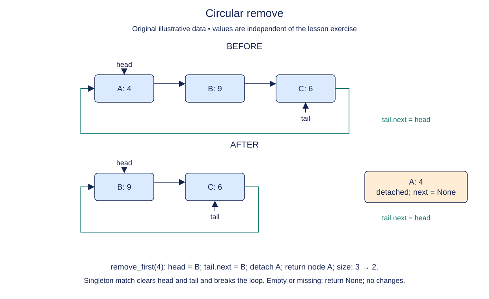

# Remove a participant and keep the ring closed

Removing from a ring combines a bounded search with endpoint repair. Start the predecessor at tail and the cursor at head. This pair is valid even before the first step because tail.next is head. In an ordinary singly linked list, the head had no predecessor; the circular link changes that case.

Search no more than the original size nodes. If no value matches in that lap, return None without change. When a match is found, bypass it through the predecessor. If the match is head, advance head. If it is tail, move tail back to the predecessor. Reestablish tail.next=head before returning.

The singleton case cannot use the ordinary bypass alone: its predecessor and successor are both itself. Removing its only node must instead clear both endpoints and set size to zero. In every successful case, clear the removed node's next so the returned object no longer participates in any ring.

Only the first equal value in head-first order is removed. Keep the other equal-valued nodes and their identities. Decrease size only after a match. Updating it for a failed comparison would corrupt the count even though no node was removed. In a `for` loop, `range(self.size)` captures its bound before iteration begins.

After a removal, use the previous one-lap values method to inspect the survivors. Then append again. A stale tail-to-head connection often appears when operations are mixed rather than tested in isolation.

## Trace it first

For `oak -> pine -> elm -> (oak)`, removing oak makes pine the head and changes elm.next to pine. Removing elm next makes pine both head and tail with a self-link. Removing pine clears the wrapper and detaches pine.next to None.

## Cost

Search takes O(n) worst-case time; the splice is O(1). Auxiliary space is O(1). Missing values require a full lap, not an unbounded walk.

## Operation contract

Implement `CircularList.remove_first(value)` to return the detached first matching node in head-first order, or `None` if absent, preserving the ring and metadata.



Circular remove. Before: A: 4 → B: 9 → C: 6. After: B: 9 → C: 6. remove_first(4): head = B; tail.next = B; detach A; return node A; size: 3 → 2. Singleton match clears head and tail and breaks the loop. Empty or missing: return None; no changes.

## Build it in three checks

The supplied cursor begins at head and its predecessor at tail. Task 1 is just the bounded search: compare the current payload before advancing, and stop on the first match. The loop's `else` already returns `None` after a complete lap with no match. At this checkpoint the method returns the matching node but does not remove it yet; do not call `values()` after a successful search until the later checks are complete.

Next, repair the ring while the old size still records the original number of nodes. For a singleton, clear head and tail. Otherwise point the predecessor past the match, move head or tail if needed, and close the ring through `tail.next`. The last check decreases size once, clears the removed node's `next`, and returns that same node. This order lets you inspect link repair separately from the detached result.

## Your Tasks

1. Stop the supplied search at the first matching node.
2. Bypass that node and repair the ring's head, tail, and closing link, including the singleton case.
3. Decrease size and detach the returned node's `next` link.

## Run and check

Edit `CircularList.remove_first` in `main.py`; keep the supplied search loop, missing-result `else`, and final return. Run after each change and **Submit** for its matching check. The starter Run probe prints `None` for an unfinished search; after all checks it prints:

```text
Ari ['Bo', 'Cy']
```

Press **Submit** to check the tasks on additional inputs and boundary cases.
