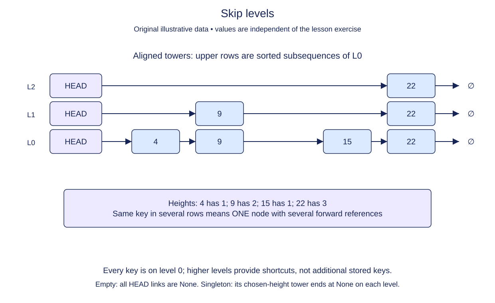

# Represent skip-list towers with forward links

A skip list keeps an ordered base chain and adds shorter chains above it. Upper links skip over some base nodes. This lesson starts a new structure with SkipNode and SkipList; circular and doubly linked classes are retained but do not provide its storage.

Each node has one key and a list of forward references. A height-three node participates at levels 0, 1, and 2, so it has three link slots. Height counts slots; the highest level index is height minus one. Every real node participates at level 0. Higher levels contain subsets of the same node objects, in the same increasing-key order.

The supplied SkipList constructor creates a sentinel head with max_level slots. Its None key is not a stored key and is never compared with real keys. An empty skip list has size zero, tail None, and every sentinel link None. A nonempty list's tail is the last level-zero node. There are no backward links.

Use a fresh forward list for each node. Repeating None references is safe because None is immutable; sharing the whole list between nodes is not. A node constructor validates a positive integer height. SkipList later validates that an insertion's height also fits its maximum.

The exercise uses explicit heights so every link arrangement is reproducible. A randomized skip list normally chooses heights by independent coin-like trials. We will discuss what that randomness does and does not guarantee after implementing the actual link operations.

`list[SkipNode | None]` describes the forward slots. `int | None` on the node key also permits the sentinel marker; ordinary stored keys in this exercise are integers. Callers must supply integer keys for stored data; the sentinel's None marker is not a supported insertion key.

## Trace it first

Imagine keys 14, 28, 43 with heights 1, 3, 2. Level zero contains all three. Level one contains 28 then 43. Level two contains only 28. The 28 node is one object referenced on several levels, not three copies of its key.

## Cost

A node of height h takes O(h) time and space to initialize its link slots. An empty wrapper with L levels takes O(L) space; it is not O(1) if L is treated as variable.

## Operation contract

Implement `SkipNode(key, height)` with the original key and a fresh `forward` list of height None links; reject non-integer, boolean, or nonpositive heights with `ValueError`.



Skip levels. Fixed level data before: L0 [4,9,15,22], L1 [9,22], L2 [22]. Every key is on level 0; higher levels provide shortcuts, not additional stored keys. Empty: all HEAD links are None. Singleton: its chosen-height tower ends at None on each level.

## Your Tasks

1. Validate `height` before initializing a SkipNode.
2. Allocate an independent forward-link list with `height` slots.

## Run and check

Edit `SkipNode.__init__` in `main.py`. The key assignment is supplied. Add validation before allocating link slots. Run the completed operation to see:

```text
24 [None, None, None]
```

Press **Submit** to check the tasks on additional inputs and boundary cases.
