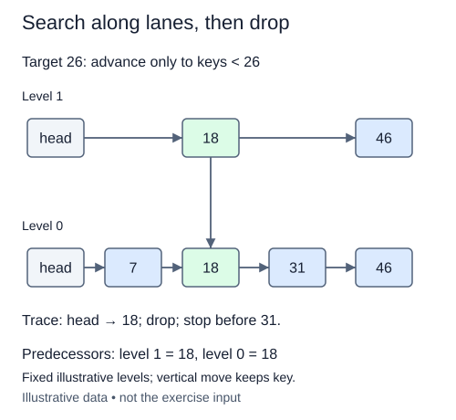

# Search top-down for every predecessor

Insertion and deletion both need the node just before a key at every level. Implement that shared search before changing any links. The returned update list is indexed by level, so update[0] is the predecessor in the base chain.

Start at the sentinel on the highest level. Move right while the next node exists and its key is strictly smaller than the target. Stop before an equal or larger key, record the current node for that level, and descend one level without returning to head. A tall node has all lower link slots, so descending from it is safe.

The search invariant is that current is before the target and no node skipped to its left can be the needed successor. An equal key must not be crossed; duplicates are not stored, and later insertion needs to detect an existing equal node. If there is no smaller real node, the sentinel is the predecessor.

The new supplied seed_skip helper constructs fixtures from already sorted, unique (key, height) pairs. It connects real node references level by level; it is not the general insertion algorithm you will implement later. Its last array remembers the last node connected at each level. Use it to inspect small towers without depending on unfinished insertion.

The task requires an actual top-down pointer walk, not collecting keys into a Python list and searching that collection. Tests inspect predecessor identities on upper levels as well as level zero.

## Trace it first

For keys 14(h1), 28(h3), 43(h2), search for 35. At level two move to 28, then descend. At level one, 43 is too large, so stay at 28. Level zero also stops at 28. Searching for 28 must stop before its tower, leaving the sentinel on upper levels and 14 at level zero.

## Cost

With L levels and n keys, the worst-case search is O(n+L), using O(L) result space. Random geometric heights with adequate levels give expected O(log n) search, not a worst-case guarantee.

## Operation contract

Implement `predecessors(key)` by following forward links from highest level down, returning one predecessor per level whose key is strictly less than key (or the sentinel); do not mutate the structure.



Fixed illustrative levels; vertical move keeps key.

## Your Tasks

1. Implement `predecessors(key)` as a top-down pointer walk.

## Run and check

Edit `SkipList.predecessors` in `main.py`. The earlier definitions and Run probe are supplied. Run the completed operation to see:

```text
[24, 24, 24, None]
```

Press **Submit** to check the tasks on additional inputs and boundary cases.
