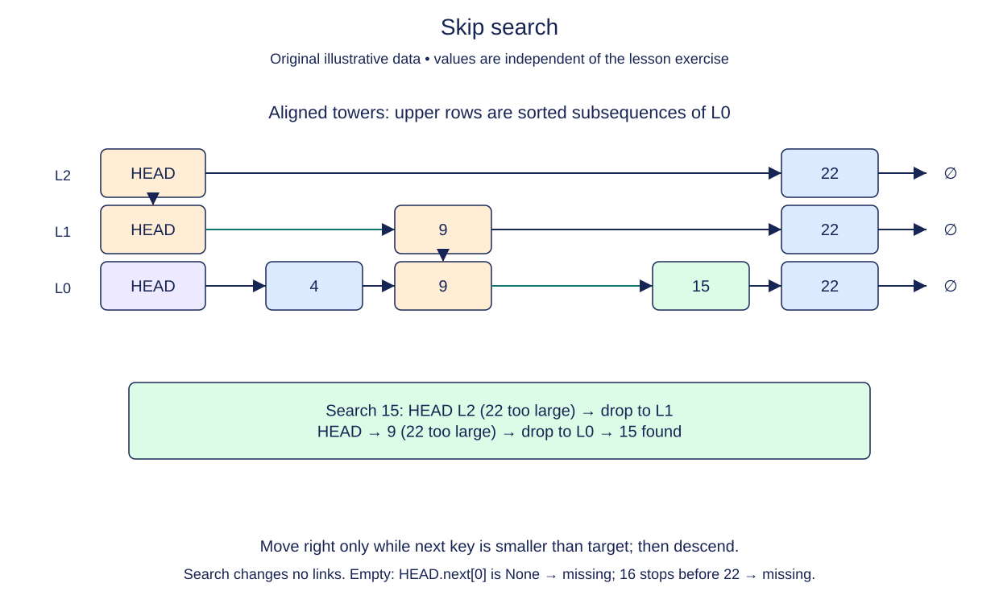

# Check the successor after a skip search

Predecessor search stops before the requested key. That stopping point is useful whether the key exists or not, but it is not itself a successful lookup. Search must inspect the next base-level node and compare its key with the target.

The predecessor result at level zero identifies the greatest stored key strictly below the target, or the sentinel. Its successor is the only possible exact match because the base chain is sorted and unique. If that successor is None, the target lies after every stored key or the structure is empty. If its key is larger than the target, the target is absent.

Return the existing SkipNode object on success. Do not return the predecessor, a boolean, or a freshly allocated node with the same key. Callers may inspect that node's height or retain its identity. Return None on failure and leave all links and metadata unchanged.

The completed predecessors method and supplied seed_skip builder remain unchanged. This stage is intentionally short: it turns a reusable positioning operation into an exact-membership operation. Keeping the two concerns separate makes insertion and removal easier to reason about next.

Our real keys are integers and comparisons are assumed constant-cost for these examples. The sentinel's None key is never part of an ordering comparison. It is a structural starting point, not a smallest integer value.

## Trace it first

For `11 -> 26 -> 48`, searching for 30 leaves the base predecessor at 26 and candidate at 48. Because 48 is not 30, return None. Searching for 26 leaves predecessor at 11 and candidate at 26, so return that candidate object.

## Cost

This wrapper adds O(1) work after predecessor search. Its total worst-case time is O(n+L) and auxiliary space O(L), because predecessors returns an L-element array. Expected logarithmic time needs suitable randomized heights and enough levels.

## Operation contract

Implement `search(key)` using `predecessors(key)` and the level-zero successor; return the matching existing node or `None` without mutation.



Skip search. Fixed level data before: L0 [4,9,15,22], L1 [9,22], L2 [22]. Move right only while next key is smaller than target; then descend. Search changes no links. Empty: HEAD.next[0] is None → missing; 16 stops before 22 → missing.

## Your Tasks

1. Implement `search(key)` using the completed predecessor search.

## Run and check

Edit `SkipList.search` in `main.py`. The earlier definitions and Run probe are supplied. Run the completed operation to see:

```text
24 None
```

Press **Submit** to check the tasks on additional inputs and boundary cases.
