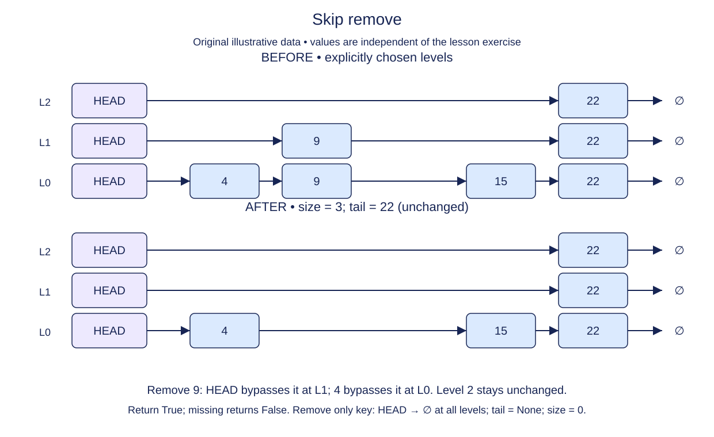

# Remove a tower from every participating level

Deleting only a base-level link is not enough. A higher level could still lead into the supposedly removed node, making later searches find a ghost entry. Removal must bypass the same tower on every level where it participates.

Use the completed predecessors method to locate the candidate at level zero. Confirm exact equality before making any change. A missing candidate or a larger successor means the key is absent; return False and keep size unchanged.

For a present key, each predecessor at a participating level points directly to the candidate. Redirect that link to the candidate's successor on the same level. Clear each removed forward slot after using it. The node object can remain alive through an outside reference, but none of its links should lead back into the live index.

If the removed node was tail, its level-zero predecessor becomes the new tail. When that predecessor is the sentinel, the list has become empty and tail must be None. The sentinel itself remains allocated with max_level slots, all None in the empty state. Decrease size once regardless of the tower's height.

The duplicate policy simplifies removal: there is at most one node with the key. Keep all surviving node identities and heights. Reinsert a removed key with a different supplied height to check that the old tower was fully disconnected.

## Trace it first

Suppose 28 appears on levels zero, one, and two between smaller and larger keys. Removing it repairs three links, not just one. If level two contained only 28, the sentinel's level-two link becomes None. Lower levels may still contain other nodes.

## Cost

Removal costs O(n+L) in the worst case and O(L) auxiliary search space. Expected time is O(log n) with appropriate randomized heights; clearing a height-h tower adds O(h) work.

## Operation contract

Implement `SkipList.remove(key)` to unlink the existing tower at every level, clear its forward links, update size/tail, and return `True`; return `False` without mutation for an absent key.



Skip remove. Fixed level data before: L0 [4,9,15,22], L1 [9,22], L2 [22]. Remove 9: HEAD bypasses it at L1; 4 bypasses it at L0. Level 2 stays unchanged. Return True; missing returns False. Remove only key: HEAD → ∅ at all levels; tail = None; size = 0.

## Build it in three checks

The starter already gets the predecessor array and its level-zero successor. First, distinguish a matching candidate from an empty slot or a larger successor. Return `False` without mutation in either missing case; the supplied `True` return is provisional for a match. This check works even while the links are still untouched.

For the next check, iterate only through the candidate's own tower height. At each level, bypass the candidate with that level's predecessor and clear its outgoing slot after using it. The earlier predecessor search guarantees that each of those links points to this same node. Keep the tail and size edits for the final check: if the candidate was tail, its base predecessor becomes tail (or `None` when that predecessor is the sentinel). Subtract one from size once, not once per level. The final `True` now reports a completed removal.

## Your Tasks

1. Return `False` for a missing key without changing the index.
2. Unlink the matching tower at every participating level and clear its forward slots.
3. Repair tail if needed and decrease size once.

## Run and check

Edit `SkipList.remove` in `main.py`. Keep its supplied predecessor lookup and provisional `True` return. Run after each change and **Submit** for its matching check. The starter Run probe remains bounded even before links are unlinked; after all checks it prints:

```text
True None 2
```

Press **Submit** to check the tasks on additional inputs and boundary cases.
