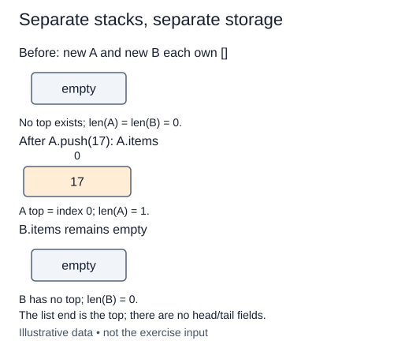

# Choose the top and initialize a stack

A stack restricts a sequence to one active end. Push adds at that end, peek reads it, and pop removes it. The most recently pushed item is the first removed, a rule called last in, first out. This restriction is useful when a newer action must finish before an older one resumes.

This module starts a new representation: Stack stores its values in a Python list and uses the list's final position as the top. The completed linked structures from previous modules are not copied into this starter. Python's list is appropriate here because append and final-position pop avoid shifting all earlier elements. A linked stack could instead use the head of a singly linked chain for both push and pop; using its tail for pop would require finding a predecessor.

Initialize a fresh items list on self during each constructor call. Do not put a mutable shared list on the class. The supplied `__len__` method returns len(items), so there is no separate size counter to become stale. An empty stack has no top; a singleton's only element is both its oldest and newest item.

This representation has no node head or tail fields. Its invariant is that items holds values from bottom to top, and the public size is exactly len(items). Later operations must preserve that order. Payloads are stored by reference, and duplicate values are allowed.

Only initialization is unfinished. The following lessons add push, peek, and pop separately before using them in applications.

`Any` in the supplied annotations means this general-purpose stack accepts payloads of different types. Applications narrow that contract: the bracket checker stores characters, arithmetic stores integers, and the minimum stack stores integer pairs. `list[Any]` describes storage, not a second stack interface.

## Trace it first

If a stack eventually receives sketch, edit, then export, its bottom-to-top storage is `["sketch", "edit", "export"]`. Export is the next item to remove. A second newly created stack must still be empty; creating it does not borrow the first stack's items.

## Cost

Creating an empty stack takes O(1) time and space. The supplied length operation is O(1). Storage grows to O(n) references for n items.

## Operation contract

Implement `Stack.__init__()` with a fresh empty instance list named `items` for each stack.



The list end is the top; there are no head/tail fields. Original illustrative example; not exercise input.

## Your Tasks

1. Initialize a fresh empty `items` list for this Stack.

## Run and check

Edit `Stack.__init__` in `main.py`. The earlier definitions and Run probe are supplied. Run the completed operation to see:

```text
[] 0 False
```

Press **Submit** to check the tasks on additional inputs and boundary cases.
