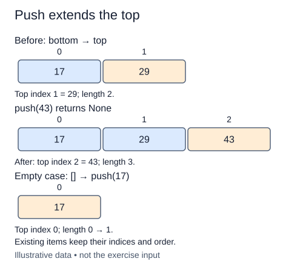

# Push onto the final position

Push adds one item above all existing items. Our stack uses the final Python-list position as the top, so append is the operation that matches the representation. Inserting at position zero would place the new item at the bottom and shift existing references unnecessarily.

The completed constructor gives each stack its own list, and `__len__` reads that list's length. Push does not maintain a second count. Once the value has been appended, the length already reflects the new state.

Preserve the value as a reference rather than copying it or converting it to text. If the caller pushes a mutable record, the stack holds that same record. Repeated equal values occupy separate stack positions even if they refer to the same underlying object. A pushed None is also valid data; it does not mean the stack is empty.

The method's return value is None. The change to stack state is its result, rather than a returned list or the new size. Later peek and pop will return values. Keeping these contracts distinct helps callers avoid accidentally replacing their stack variable with the result of push.

The task is small, but its endpoint choice determines the cost of every application that follows. Keep the earlier definitions unchanged and use the supplied probe to inspect bottom-to-top storage after two pushes.

## Trace it first

Starting with `["rough"]`, pushing "proof" produces `["rough", "proof"]`. The previous item stays at index zero; the top becomes the final element. Pushing "proof" again creates a third position, not a uniqueness check.

## Cost

Python list append is amortized O(1), not guaranteed O(1) for each individual call: occasional storage growth copies references. The stack uses O(n) total storage for n positions.

## Operation contract

Implement `Stack.push(value)` to append the original value reference at the top and return `None`.



Existing items keep their indices and order. Original illustrative example; not exercise input.

## Your Tasks

1. Implement `push(value)` to add the value at the stack top.

## Run and check

Edit `Stack.push` in `main.py`. The earlier definitions and Run probe are supplied. Run the completed operation to see:

```text
['draft', 'review'] 2
```

Press **Submit** to check the tasks on additional inputs and boundary cases.
