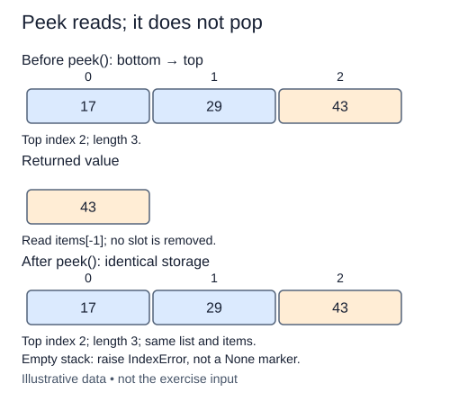

# Peek without consuming the top

Sometimes a caller needs to inspect the next item without removing it. Peek reads the final list position and leaves every stack position intact. Calling peek twice should return the same object if nothing changed between the calls.

The empty case needs an explicit contract. There is no top value, so raise IndexError. Returning None would be ambiguous because None is a valid pushed value. An exception distinguishes an empty stack from a nonempty stack whose top happens to be None.

A singleton requires no special indexing rule: its final element is its only element. For longer stacks, do not return the first element; that is the bottom. Avoid pop followed by push as a way to inspect the top. Although it can restore values in simple cases, it performs unnecessary mutations and obscures the read-only contract.

The supplied constructor, length method, and push are complete. Check both value equality and object identity when the top is mutable. Peek must not copy the payload. The caller may later mutate that object, but peek itself must not change the stack's membership or order.

This separation between inspection and removal will matter for bracket matching and minimum tracking. Those algorithms sometimes need information about the top while deciding whether to consume it.

## Trace it first

A stack with bottom-to-top values `["open", "close"]` peeks as "close" and remains unchanged. After pushing None, peek returns None while len is three. On a genuinely empty stack, peek raises instead of returning a marker.

## Cost

Peek takes O(1) time and O(1) auxiliary space. It does not scan, allocate a copy, or resize storage.

## Operation contract

Implement `Stack.peek()` to return the top value without mutation, raising `IndexError` on an empty stack.



Empty stack: raise IndexError, not a None marker. Original illustrative example; not exercise input.

## Your Tasks

1. Implement `peek()` to inspect the top without removing it.

## Run and check

Edit `Stack.peek` in `main.py`. The earlier definitions and Run probe are supplied. Run the completed operation to see:

```text
review ['draft', 'review']
```

Press **Submit** to check the tasks on additional inputs and boundary cases.
