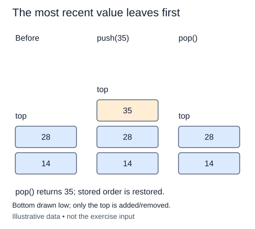

# Pop in last-in-first-out order

Pop consumes the item that peek only observes. In this representation the top is the final list element, so remove that final position. The result must be the original value reference, not its string form or a copy.

If values were pushed in order A, B, C, successful pops must return C, B, A. Removing index zero would implement first-in-first-out behavior instead and would shift the remaining references. A stack's meaning depends on consistent endpoint use, not just on having methods named push and pop.

Raise IndexError when no items exist. Check the collection's emptiness rather than the truthiness of its top value: zero, False, empty strings, and None are valid items. Removing the last item leaves an ordinary empty list, which should accept a later push without reset.

The length method reads the storage directly, so every successful pop lowers the reported size automatically. Peek remains read-only. The earlier methods are unchanged in the starter; only pop is unfinished.

This completes the basic stack interface. The remaining lessons use it to manage unfinished brackets, arithmetic operands, and prior states. Those applications should not need to know whether the stack uses a Python list or linked nodes as long as the same public contracts hold.

## Trace it first

For bottom-to-top storage `["save", "rename", "publish"]`, the first pop returns "publish" and leaves two items. The second returns "rename". After the third, a fourth pop raises IndexError. A new push afterward starts a new nonempty sequence.

## Cost

Final-position Python list pop is amortized O(1); occasional storage resizing can cost O(n). It avoids the O(n) shifting of pop(0). Auxiliary work apart from storage management is O(1).

## Operation contract

Implement `Stack.pop()` to remove and return the top value, raising `IndexError` on an empty stack without mutation.



Bottom drawn low; only the top is added/removed.

## Your Tasks

1. Implement `pop()` to remove and return the top value.

## Run and check

Edit `Stack.pop` in `main.py`. The earlier definitions and Run probe are supplied. Run the completed operation to see:

```text
review draft 1
```

Press **Submit** to check the tasks on additional inputs and boundary cases.
