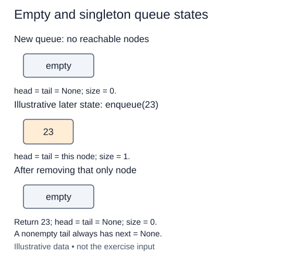

A workshop receives repair tickets in arrival order. The oldest waiting ticket should be served before a newer one. A queue expresses that rule: enqueue adds at the rear, dequeue removes at the front. This is first-in, first-out, or FIFO. A stack would reverse the service order.

We will build `LinkedQueue` one method at a time. The supplied `Node` holds a `value` and a `next` reference. The queue itself holds `head`, `tail`, and `size`. `head` points to the next node to serve; `tail` points to the most recently added node. Keeping both references avoids walking the chain to find its rear on every insertion.

Before any ticket arrives, there is no first or last node. Both references must be `None`, and the number of waiting items must be zero. These statements form the empty-state invariant: facts that every method must leave true whenever the queue becomes empty. A one-node queue will instead have `head is tail`; that node's `next` will be `None`.

Consider a different queue containing the labels `"paint"` then `"dry"`. Its head would hold `"paint"`, its tail would hold `"dry"`, and its size would be two. Do not create those nodes yet. This stage is only the constructor. After you complete it, the Run probe reports the three empty-state fields; before that it may report a field that has not been created yet.

The hints `object` and `Node | None` describe a flexible payload and an optional node reference. The arrow after a method signature describes its return type; `-> None` means the method returns no useful result. The future-annotations import permits the node class to name itself before its definition has finished. These hints document intent rather than enforce it at runtime. The supplied class-body annotations declare the field types but do not assign values; your constructor still needs to create each field on `self`.

Put the attributes on `self` inside `__init__`, not on the class. Each new queue needs its own state. The constructor takes O(1) time and O(1) space; later nodes will occupy O(n) total space for n waiting items. We count reference assignments as constant-time operations.

The later states show the invariant your constructor establishes; enqueue and dequeue come next.

## Build it in small steps

The first check reads only the endpoints. The size check is separate, so you can finish the constructor a field group at a time.

## Your Tasks

1. Set `head` and `tail` on the new queue to `None`.
2. Set the new queue's `size` to zero.

Edit `main.py` one step at a time. Run uses the supplied probe; an unfinished field or return value may print a reminder. Submit checks the numbered steps in order, so you can see each completed step before finishing the next.
