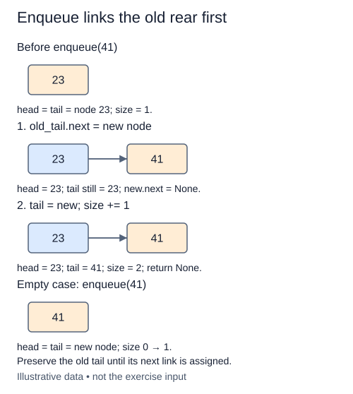

The constructor is complete in this starter. Your new method will attach a ticket without disturbing the one already at the front.

Allocate one `Node(value)`. Its `next` is already `None`, so it is ready to become the final node. There are two cases. For an empty queue, the new node is both the first and last node. For a nonempty queue, the old tail's `next` must point to the new node. Only after that link exists should `tail` move to the new node. If you overwrite the old tail reference too early, you lose the place where the link belongs.

For example, a queue holding `"wash"` receives `"rinse"`. The head must still be the original wash node. That node now points to rinse, and the tail points to rinse too. Adding at the head would silently turn this queue into a stack, even though both implementations contain the same values.

Increase `size` exactly once for every call, including duplicate values and `None`. `None` is a valid stored value; an empty queue is identified by its node references, not by inspecting a node's value. Return `None`, the usual return value of a mutating method without an explicit result.

This operation uses O(1) pointer work and allocates one node. It is not a list append that occasionally resizes a backing array, so the linked-structure operation does not need an amortized qualifier under this allocation model. The Run probe shows the oldest and newest values beside the size. Trace the links as well to check that every arrival remains reachable.

Follow the old tail in the middle row: its link must be written before the tail reference moves.

## Build it in small steps

Start with the empty branch. The second check adds further arrivals only after the first branch works.

## Your Tasks

1. Handle an empty queue in `enqueue`: link the new node as both endpoints and increase size.
2. Handle a nonempty queue: link after the old tail and advance tail and size.

Edit `main.py` one step at a time. Run uses the supplied probe; an unfinished field or return value may print a reminder. Submit checks the numbered steps in order, so you can see each completed step before finishing the next.
