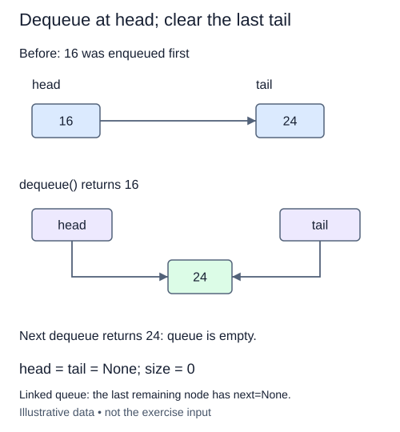

A completed enqueue is supplied. Dequeue now serves the oldest waiting ticket. Save the head node before moving `head` to its successor: the saved node still holds the value you need to return.

Suppose the chain contains `"cut"`, `"fold"`, and `"pack"`. Removing cut should leave fold as the head and pack as the tail. It must not traverse to the rear or return pack. After moving the head, clear the removed node's `next`. This detaches the removed node so a reference retained elsewhere does not keep pointing into the live queue.

The singleton case needs one extra update. Once the only node has been removed, `head` is `None`. Set `tail` to `None` as well; a stale tail could cause the next enqueue to attach a node to a chain the queue no longer reaches. Reduce `size` once on success, never on failure.

An empty queue raises `IndexError`. Returning `None` instead would be ambiguous because callers may enqueue `None` as a real item. The Run probe can report unusable state while a step is unfinished. Submit calls the method directly: your finished queue must return the stored value or raise the documented exception.

Dequeue takes O(1) time and O(1) temporary space. Draining n items takes O(n) total pointer work. A Python list's `pop(0)` shifts the remaining references and has a different cost; this exercise deliberately uses links. Try draining the queue and filling it again, not just removing once from a long chain.

The first removal leaves node 24 as both endpoints. The second must clear both endpoints, not just head.

## Build it in small steps

Empty input, ordinary removal, and the last-node repair have separate checks. The ordinary-removal check deliberately starts with three nodes.

## Your Tasks

1. Raise `IndexError` when `dequeue` receives an empty queue.
2. Remove and detach the head of a queue with multiple nodes, returning its value and reducing size.
3. Clear tail when removal empties the queue.

Edit `main.py` one step at a time. Run uses the supplied probe; an unfinished field or return value may print a reminder. Submit checks the numbered steps in order, so you can see each completed step before finishing the next.
