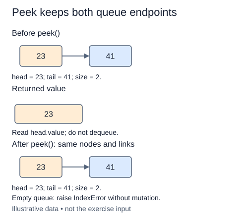

The service desk needs to display the next ticket while leaving it in the queue. `peek` reads the head value but does not remove the node. All earlier methods are carried forward unchanged.

For a queue holding `"inspect"` then `"label"`, two consecutive peeks both return `"inspect"`. A later dequeue must also return inspect. Calling dequeue and then enqueue to simulate a peek would move inspect to the rear, which changes the service order. Even removing and reinserting at the front would do unnecessary mutation.

Check the empty condition before reading `head.value`. An empty queue raises `IndexError`, matching dequeue. A nonempty queue whose first value is `None` returns `None` normally. The distinction depends on whether a node exists, not whether its stored value is truthy. Zero, an empty string, and `False` are also legitimate values.

The invariant for this operation is stronger than merely preserving size. The exact same head and tail nodes, and the exact same links, should remain in place. Think of peek as a read-only observation of the next service event. The checks retain node references across repeated calls to catch accidental removal.

Reading the head takes O(1) time and O(1) extra space. Finding an arbitrary ticket by value would still take O(n), but that is not the operation a queue is designed to provide. You now have a complete linked FIFO interface that later algorithms can use without knowing its pointer details.

The returned 23 is a value, not a new node or a one-item list. Neither endpoint moves.

## Your Tasks

1. Raise `IndexError` when `peek` receives an empty queue.
2. Return the head value without changing a nonempty queue.

Edit `main.py` one step at a time. Run uses the supplied probe; an unfinished field or return value may print a reminder. Submit checks the numbered steps in order, so you can see each completed step before finishing the next.
