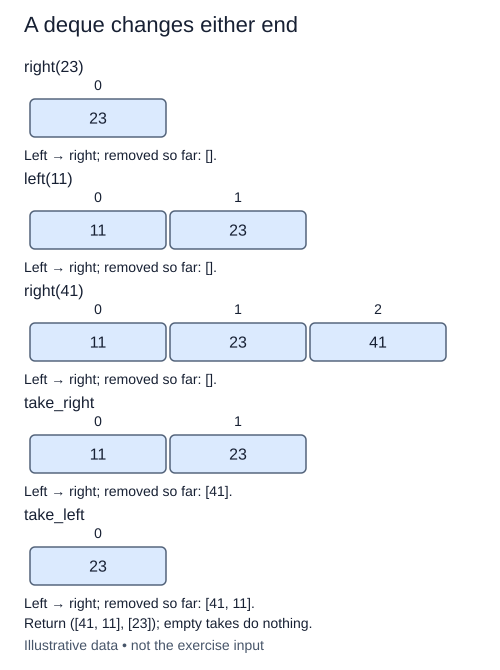

A queue has one entrance and one exit. A deque, pronounced "deck", allows additions and removals at either end. Use it when urgent work may join the front while ordinary work joins the rear.

This is a fresh application using `collections.deque`, not a rewrite of the linked class. The supplied import makes the container available. `append(value)` adds at the right, `appendleft(value)` adds at the left, `pop()` removes from the right, and `popleft()` removes from the left. `list(waiting)` takes an ordered snapshot when you need an ordinary list for a result.

For a separate example, start with a deque containing `"reed"`. Append `"pine"` on the right and `"oak"` on the left. Its left-to-right order is oak, reed, pine. Popping on the right removes pine; popleft removes oak. The words left and right refer to these positions, not to a priority rule built into the container.

Your function receives `(operation, value)` pairs. `left` and `right` add the supplied value. `take_left` and `take_right` ignore the value field and record the removed item. An attempted removal from an empty deque does nothing. An unknown operation raises `ValueError`. Return `(removed, remaining)` as two lists, leaving the input commands unchanged.

Each end operation has O(1) cost in the standard deque model. Building the result over c commands takes O(c) time, plus the final snapshot, and O(c) space in the worst case. By contrast, `list.insert(0, value)` and `list.pop(0)` shift references. Use the deque operations here rather than reproducing those shifts.

Read each row from left to right. Removed values accumulate separately from the items still waiting.

## Build it in small steps

The command branches and result lists are supplied. Fill one branch at a time; removals build on the earlier addition branches.

## Your Tasks

1. Implement the `right` command with a rear append.
2. Implement the `left` command with a front append.
3. Implement `take_left`, recording the removed value only when an item exists.
4. Implement `take_right` with the same empty-removal policy.
5. Raise `ValueError` for an unknown command.

Edit `main.py` one step at a time. Run uses the supplied probe; an unfinished field or return value may print a reminder. Submit checks the numbered steps in order, so you can see each completed step before finishing the next.
