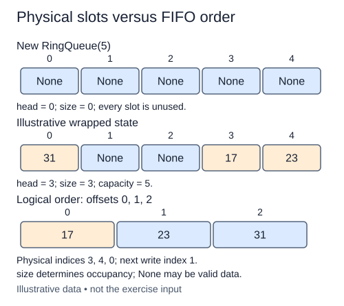

A small sensor controller reserves a fixed number of queue slots. It should reuse those slots as readings leave, without allocating a node for each reading. We will start a fresh `RingQueue` implementation with a fixed list named `data`.

The queue's `head` is the physical index of the oldest item. `size` is the number of occupied slots. Capacity is `len(data)` and never changes. Logical item offset j lives at `(head + j) % capacity`. The remainder wraps an index back to the beginning of the list. Physical index order and service order can therefore differ.

For example, with capacity five, head four, and size three, the occupied physical slots are four, zero, and one. Reading the list from slot zero would not give queue order. The next insertion belongs at logical offset three, so it would use slot two. You will implement that calculation in the next lesson; this stage establishes valid initial state.

Use a positive integer capacity. Reject zero, negative values, floats, and booleans with `ValueError`. In Python a boolean is an integer subclass, so `type(capacity) is int` expresses this exercise's exact-type policy. The queue starts with a new list of `None` slots, head zero, and size zero. Occupancy will be determined by size, not by slot contents, because `None` can itself be a queued value.

The constructor takes O(capacity) time and space to allocate the slots. Once allocated, each enqueue or dequeue will use O(1) index work with no resize. This is a bounded queue: a full queue will reject an insertion rather than silently overwrite unread data.

The lower row shows logical offsets, not physical slot numbers. Size tells you how many offsets to follow from head.

## Build it in small steps

Validation comes first. The storage check does not read head or size, so it can pass before the final state fields exist.

## Your Tasks

1. Reject an invalid capacity with `ValueError`.
2. Allocate an independent `data` list containing capacity empty slots.
3. Initialize `head` and `size` to zero.

Edit `main.py` one step at a time. Run uses the supplied probe; an unfinished field or return value may print a reminder. Submit checks the numbered steps in order, so you can see each completed step before finishing the next.
