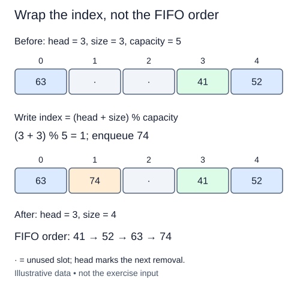

The fixed storage constructor is supplied. Add a value at the logical rear of the queue, which is not always the last physical slot in `data`.

The occupied offsets are zero through `size - 1`. The next free offset is therefore `size`, measured from `head`. Add those two numbers and take the remainder by capacity. With capacity six, head five, and size two, the existing items occupy slots five and zero. The new item belongs in slot one. Increasing size before computing the position would skip that slot.

Check for a full queue first. When `size == len(data)`, no free slot remains. Raise `OverflowError` and leave every field unchanged. An empty physical slot cannot be recognized by testing for `None`: the caller is allowed to enqueue `None`. Size is the occupancy authority.

Store the new value, then increase size once. Keep head and the storage length unchanged. Do not append to the list; appending would violate the fixed-capacity representation and avoid learning wraparound. The tests include a valid wrapped state constructed directly because dequeue has not been implemented yet. That setup is test scaffolding, not another task.

Each successful or rejected enqueue takes O(1) time and uses O(1) extra space. There is no occasional growth copy, so this operation is worst-case O(1) under our bounded-index model rather than merely amortized O(1). The earlier constructor paid for the storage allocation.

Here the physical write wraps to slot 1 while head stays at slot 3. Compute the write position using size before increasing it.

## Your Tasks

1. Raise `OverflowError` for a full ring without changing it.
2. Write the value into the wrapped rear slot without moving head.
3. Increase size after a successful write.

Edit `main.py` one step at a time. Run uses the supplied probe; an unfinished field or return value may print a reminder. Submit checks the numbered steps in order, so you can see each completed step before finishing the next.
