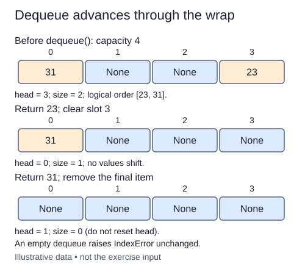

A ring reuses storage by moving indices, not by shifting the list. The starter already enqueues correctly. Your dequeue reads the value at head, clears that slot, advances head by one with wraparound, and reduces size.

Save the value before clearing the slot. Clearing to `None` releases the queue's reference to the removed object; it does not decide whether the queue is empty. For capacity four and head three, the next head is zero. Without the remainder operation, the next removal would try to read beyond the list.

An empty ring raises `IndexError` without changing its state. After a successful removal, even the final removal, advance head modulo capacity. Do not reset head to zero merely because size becomes zero. That convention gives every success the same transition, and the next enqueue already knows how to write at the current head when size is zero.

For a separate trace, enqueue `"east"`, `"west"`, and `"up"` in a capacity-three ring. Dequeue east, then enqueue down. Physical storage begins with down, but the service order is now west, up, down. Printing `data` alone cannot tell you which item comes next; read head and size alongside it.

Removal takes O(1) worst-case time and O(1) extra space. No list shifting, slicing, or growth is needed. Repeated fill-drain-refill cycles are useful checks because an implementation that works only before the first wrap is not a ring queue.

Even the final successful removal advances head. Empty means size is zero, not that head has returned to slot zero.

## Your Tasks

1. Raise `IndexError` for an empty ring without changing it.
2. Save, clear, and return the value in the head slot.
3. Advance head with wraparound and reduce size after removal.

Edit `main.py` one step at a time. Run uses the supplied probe; an unfinished field or return value may print a reminder. Submit checks the numbered steps in order, so you can see each completed step before finishing the next.
