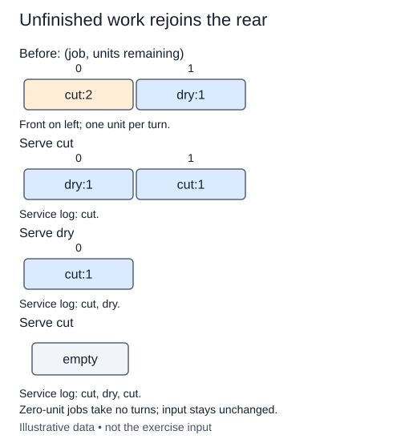

A shared workbench should not let one long job block all the short jobs behind it. Round-robin scheduling takes the front job, performs one unit of work, and sends unfinished work to the rear. A finished job leaves the queue.

This is a fresh function using `collections.deque`; the linked and ring queues explained the ordering rule. Each input pair is `(name, units)`, where units must be a nonnegative integer other than bool. Names are labels and may repeat. Zero-unit jobs need no turn. Validate the units before scheduling, then put positive-unit pairs into a new deque so the caller's list remains unchanged.

For example, `[("glaze", 2), ("fire", 1)]` produces the service log `["glaze", "fire", "glaze"]`. The log records each unit of service, not only completion. After the first glaze turn, its remaining count is one and it joins the rear behind fire. Appending it to the front would make it run again immediately and defeat the schedule.

On each iteration remove one pair from the left, record its name, and reduce the remaining count by one. Requeue only if the count is still positive. The total remaining work decreases on every iteration, which explains why the loop terminates for valid finite input.

If there are n input jobs and U total requested units, construction and processing take O(n + U) time. Queue storage is O(n); the returned log requires O(U) space. This is a simulation, not a promise that all jobs take equal real-world time. The one-unit quantum is part of the exercise contract.

The rows show one unit of service per turn. A finished job leaves instead of rejoining the rear.

## Build it in small steps

Three small functions separate input validation, queue setup, and the service loop. `queue_jobs` assumes validated input; the completed scheduling function calls validation before it calls that helper.

## Your Tasks

1. Complete `validate_jobs` to reject negative, boolean, and noninteger work counts.
2. Complete `queue_jobs` to enqueue only positive-work pairs in arrival order.
3. Complete `round_robin` to service one unit per turn and requeue unfinished jobs.

Edit `main.py` one step at a time. Run uses the supplied probe; an unfinished field or return value may print a reminder. Submit checks the numbered steps in order, so you can see each completed step before finishing the next.
