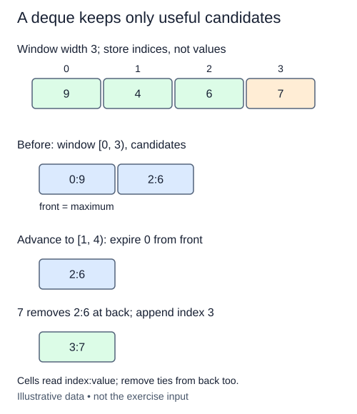

A temperature logger wants the largest reading in each consecutive window of width k. Scanning every window independently repeats comparisons. A monotonic deque keeps only readings that could still become a future maximum.

Store indices, not just values. Indices tell you when a reading leaves the window, including when several readings have the same value. Before reporting the window ending at index i, every candidate must be in the inclusive range `i - k + 1` through i. Candidate indices increase from front to rear. Their values decrease from front to rear, so the front names the maximum.

Process each new index in three steps. First remove front indices smaller than the window's left edge. Next remove rear candidates whose values are less than or equal to the new value. Finally append the new index. Removing a smaller rear value is safe: the new reading is at least as large and expires later, so the older candidate cannot win any future window containing the new one. With equal values, keeping the newer index is sufficient for the same reason. Keeping both equal candidates is also correct if your expiration rule is sound.

For a different trace, readings `[4, 1, 6, 2]` with width three produce maxima six and six. When six arrives, it makes both older candidates unnecessary. When two arrives, six stays at the front because two cannot replace it. Do not output partial windows: the first result appears only after k readings.

Require an integer k with `1 <= k <= len(values)`, excluding bool; otherwise raise `ValueError`, including for an empty input. Leave values unchanged. Use a deque and do not call `max` or sort windows. One new reading can remove O(k) candidates, but each index enters once and leaves at most once. Thus total work is O(n), or amortized O(1) deque work per reading, not worst-case O(1) per reading. Candidate space is O(k), plus the returned maxima.

Moving from window [0, 3) to [1, 4) expires index 0 at the front, then the incoming 7 removes the weaker 6 at the back. These are different reasons for discarding a candidate.

## Build it in small steps

The candidate-update helper receives a deque that already satisfies the invariant for the preceding index. It updates that same deque in place. Test that one-step transition before connecting it to the loop that collects completed windows.

## Your Tasks

1. Complete `validate_window` with the width and empty-input rules.
2. Complete `advance_candidates` to expire old indices, discard dominated rear candidates, and append the current index.
3. Complete `window_maxima` to call both helpers and collect the front value after each full window.

Edit `main.py` one step at a time. Run uses the supplied probe; an unfinished field or return value may print a reminder. Submit checks the numbered steps in order, so you can see each completed step before finishing the next.
