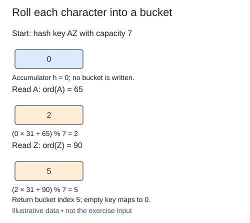

A stockroom wants to retrieve a quantity by its label rather than scan every stored record. A hash table first turns that key into a bucket index. It then checks the keys inside that bucket. The index narrows the search; it does not prove which key is present.

Our teaching hash accepts strings, including the empty string and Unicode text. Start an accumulator at zero. For each character, multiply the current accumulator by 31, add `ord(character)`, and reduce modulo capacity. `ord` returns a Unicode code point, not merely an ASCII code. Reducing after every character keeps the accumulator in the bucket range and avoids building an unnecessarily large integer.

For a separate one-character example, `ord("Z")` is 90. With seven buckets its bucket is six. A longer string repeats the update for each character in order. Multiplication makes order matter, although different keys can still reach the same index. Such a collision is normal when many possible strings map to a limited number of buckets.

Require capacity to be a positive integer, excluding bool, and raise `ValueError` otherwise. The empty key performs no updates and maps to bucket zero. This function does not store anything yet. Later lessons will reuse it unchanged, which makes their examples reproducible across runs.

The function takes O(L) time for a key of length L and O(1) working space under the bounded-capacity arithmetic model. Do not describe hashing an arbitrary-length string as free. This polynomial is a teaching function, not a security mechanism or a guarantee of a good distribution. Python's built-in string hash may vary between processes; we use an explicit rule so bucket traces remain repeatable.

Each row is an accumulator update, not a write into a bucket. The final accumulator is the returned index.

## Build it in small steps

Capacity validation has its own helper and check. After it works, the hash function can call it before doing the character fold.

## Your Tasks

1. Complete `validate_capacity` to accept positive integers other than bool and reject everything else with `ValueError`.
2. Complete `bucket_index` to call validation and fold the string characters into a rolling bucket index.

Edit `main.py` one step at a time. Run uses the supplied probe; an unfinished field or return value may print a reminder. Submit checks the numbered steps in order, so you can see each completed step before finishing the next.
