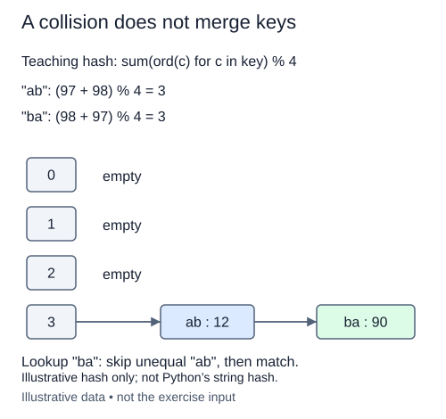

A bucket index cannot uniquely identify a key. With capacity one, every string goes into bucket zero, no matter how carefully its hash was computed. Losing one record whenever this happens would make a hash table unusable.

Separate chaining keeps a collection at each bucket. We will use ordinary lists for those collections. Linked chains are another representation, but list buckets let us focus on matching keys rather than repeat pointer code. At this stage the values are just keys. The later table will store `(key, value)` pairs.

The supplied `bucket_index` is complete. Create one new empty list per bucket, then append each input key to its computed bucket. Preserve input order inside a bucket and retain repeated occurrences. This grouping exercise is not yet a mapping: duplicate input keys are deliberately kept rather than updated.

For example, put `"sun"`, `"rain"`, and `"sun"` into a single bucket. That bucket must contain all three occurrences in that order. With several buckets, avoid `[[]] * capacity`: it repeats references to one list. An append would then appear in every bucket. A comprehension creates a distinct list each time.

Return the list of buckets without modifying the input keys. Call the supplied `validate_capacity` helper inside `empty_buckets`, even when the keys list is empty. `bucket_index` uses that same validator, so allocation and hashing follow one capacity rule.

Creating m buckets costs O(m). Processing n keys costs their total character length plus O(n) amortized append work. Space is O(m + n) references. Collisions do not make grouping incorrect; they only mean several keys share a place. Later lookup will need equality checks to distinguish them.

This diagram deliberately uses a simpler sum-of-code-points hash, not the rolling multiplier-31 helper in your editor. Its key/value pairs preview the later mapping; this exercise stores key occurrences only. Both models still require keeping distinct colliding keys.

## Build it in small steps

Allocate the bucket collection in a helper first. The grouping function then has only the key-distribution loop to add.

## Your Tasks

1. Complete `empty_buckets` to validate capacity and return independent empty bucket lists.
2. Complete `collision_buckets` to append every key occurrence to its computed bucket.

Edit `main.py` one step at a time. Run uses the supplied probe; an unfinished field or return value may print a reminder. Submit checks the numbered steps in order, so you can see each completed step before finishing the next.
