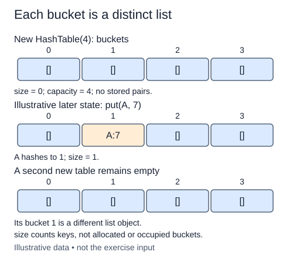

The grouping function kept duplicate keys. A mapping has a different contract: each distinct key has one current value. We now start a fresh `HashTable` class using the same hash helper and independent-bucket representation.

`buckets` is a list of lists. Each inner list will contain `(key, value)` tuples, with string keys and arbitrary object values. `size` counts stored keys, not buckets. A table with eight empty buckets has size zero. Two colliding keys will increase size to two even though they occupy just one bucket.

Complete only the constructor. Validate the requested capacity through the supplied helper, allocate fresh buckets, and initialize size. The default capacity is eight; explicit capacity must be a positive integer other than bool. No insertion or lookup is required yet, and none is hidden in a later helper that you must discover.

As a different-state example, a table might eventually hold `("brush", 4)` and `("tray", 2)` in one bucket. Storing the keys beside the values allows a later equality check to choose between them. A hash code alone cannot recover either key, so it is not enough to store only the quantities.

Each table owns its outer list and every inner bucket. Mutating a bucket in one table must not affect another table or another bucket in the same table. The type hint `list[list[tuple[str, object]]]` describes this nesting: bucket lists contain pairs whose first component is a string and whose second can be any object. Hints document the representation; they do not perform validation.

Initialization takes O(m) time and space for m buckets. Subsequent methods will be added one at a time, with this completed constructor already present in each starter.

The insertion is a later-state illustration. Your constructor only creates independent buckets and the zero key count.

## Build it in small steps

Capacity validation is supplied setup here, not a task you have to repeat. First create the bucket lists, then add the key counter.

## Your Tasks

1. Allocate independent empty buckets in `HashTable.__init__` after the supplied capacity check.
2. Initialize the distinct-key count `size` to zero.

Edit `main.py` one step at a time. Run uses the supplied probe; an unfinished field or return value may print a reminder. Submit checks the numbered steps in order, so you can see each completed step before finishing the next.
