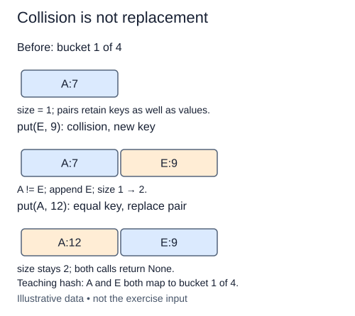

The table now needs a writing operation. `put(key, value)` either inserts a new pair or replaces the value of an equal key. The completed constructor and hash helper are supplied.

Compute the bucket index using the current number of buckets. Inspect each pair in that one bucket. Compare stored keys with `==`; equal bucket indices are not enough. If a key matches, replace the tuple at that position and return. Tuples are immutable, so replace the pair rather than assign to one tuple element.

If the scan finishes without a match, append a new pair and increase size once. Updating an existing key must not increase size. For a separate trace, writing `"glue"` with value three and then value seven leaves one glue record with value seven. Writing a different colliding label must leave both records available.

Values may be `None`, zero, or mutable objects. Store the value reference as given; do not copy or interpret it. A stored false-looking value still belongs to a real key. This stage does not resize automatically. A later operation will rebuild the buckets explicitly, so you can observe that change separately.

With n keys in m buckets and a suitable distribution, the expected bucket length is proportional to n/m. Put then takes expected O(1 + n/m) bucket work, plus key hashing and equality costs. The new-pair list append is amortized O(1), not a strict constant guarantee for each allocation. In the worst case all keys collide and a put scans O(n) pairs. Our simple hash does not promise the expected model for every input.

A and E share a bucket but are unequal keys. Only an equal key takes the replacement branch.

## Build it in small steps

The bucket-selection loop is supplied. Build the no-match insertion path first; then fill the equal-key branch for updates.

## Your Tasks

1. Append a pair and increase size when its key is not already in the bucket.
2. Replace the value of an equal key without adding a pair or changing size.

Edit `main.py` one step at a time. Run uses the supplied probe; an unfinished field or return value may print a reminder. Submit checks the numbered steps in order, so you can see each completed step before finishing the next.
