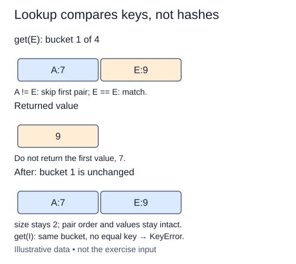

Writing is complete in this starter. Lookup follows the same route to a bucket, then compares keys until it finds the requested pair.

A bucket is a candidate collection, not a single answer. Imagine a one-bucket table with `("cloth", 5)` followed by `("wire", 8)`. Looking up wire must skip cloth. Returning the first value simply because the bucket is nonempty would confuse a collision with equality.

Return the stored value itself when the key matches. If that value is a mutable list, callers receive the same list object, not a copy. If the scan finishes without a match, raise `KeyError(key)`. This also handles an empty bucket. Do not return `None` to mean missing: storing `None` is permitted and must remain distinguishable from absence.

Lookup is read-only. It should not change size, reorder the bucket, or delete a pair after reading it. The Run probe writes its own small fixture using the supplied put method; your change is only get. Repeated lookups of an existing key should keep working, and a failed lookup must not damage neighboring colliding records.

Expected lookup cost is O(1 + n/m) bucket comparisons under a suitable distribution, plus the O(L) cost of hashing an L-character key and the cost of key comparisons. With bounded load and short keys this is often summarized as expected O(1). Worst-case lookup is O(n) comparisons when all keys land together. Neither expectation nor amortized list-append analysis guarantees a fast lookup for an adversarial collision pattern.

Hashing narrows the search to bucket 1; equality identifies E inside it. The returned 9 is the stored value, not a list.

## Your Tasks

1. Raise `KeyError(key)` after a bucket scan finds no equal key.
2. Return the value from an equal pair without changing the table.

Edit `main.py` one step at a time. Run uses the supplied probe; an unfinished field or return value may print a reminder. Submit checks the numbered steps in order, so you can see each completed step before finishing the next.
